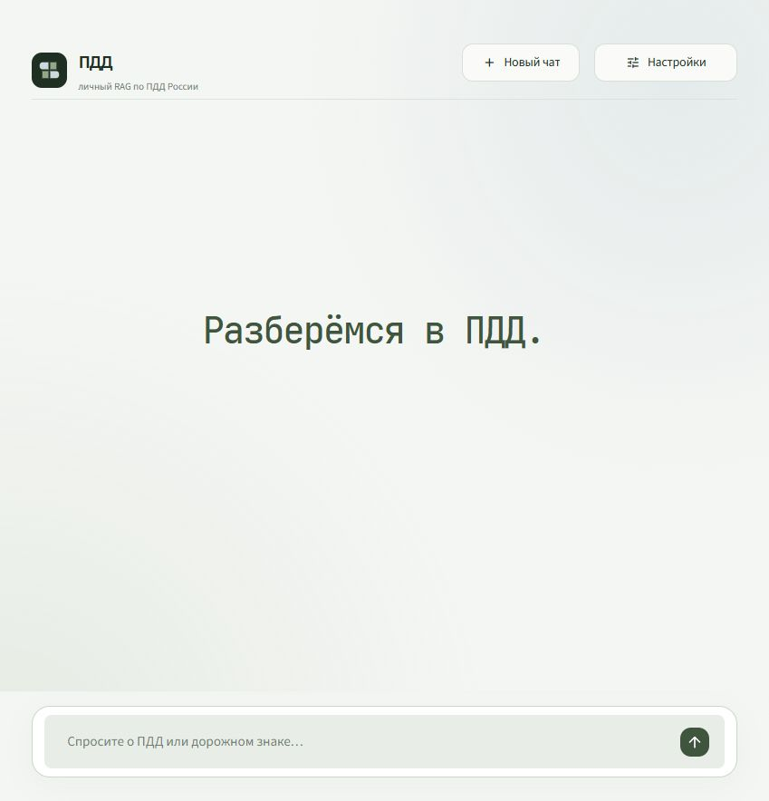
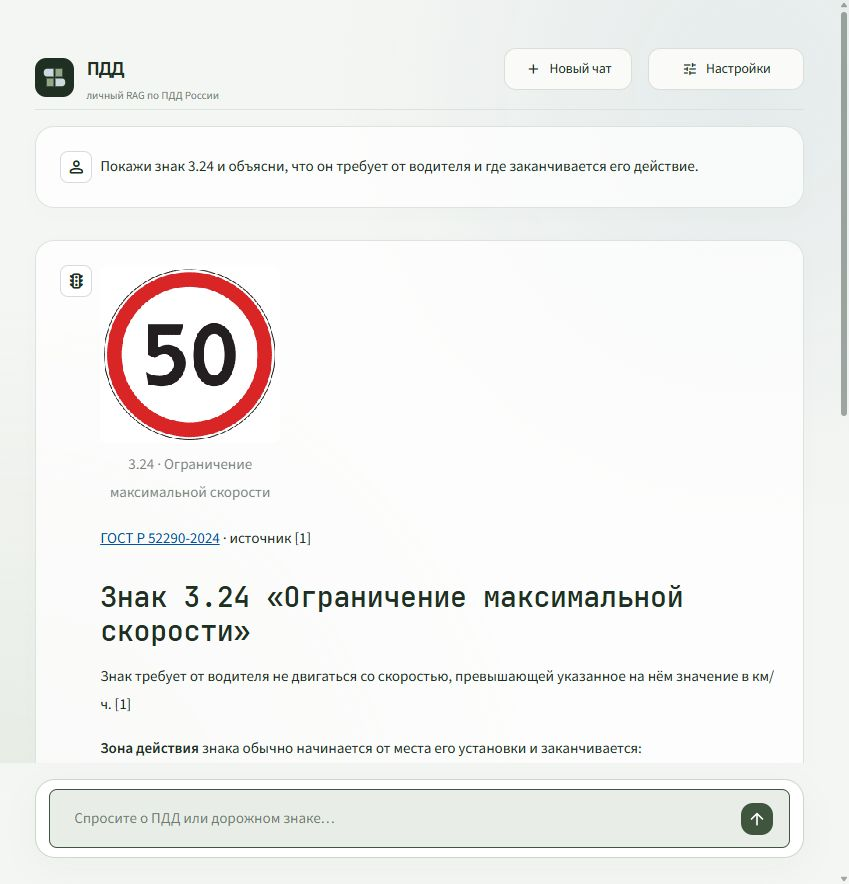

# Личный RAG по ПДД России

Локальный помощник: объясняет ПДД, показывает дорожные знаки из своего датасета и ссылается на найденные правила. На главном экране — одна фраза «Разберёмся в ПДД» и поле вопроса. Настройки находятся за отдельной кнопкой.

## Запуск

Нужен Python 3.12. Из PowerShell в папке проекта:

~~~powershell
./start.ps1
~~~

Откройте [127.0.0.1:8501](http://127.0.0.1:8501/). Ключ API введите в «Настройки → Подключение» или передайте через SUB2API_API_KEY / ROUTERAI_API_KEY в запускающем процессе. Ключи не сохраняются. Внутренней квоты запросов нет; перерисовка страницы не отправляет запрос повторно.

При первом запуске подготовьте базу через «Настройки → Поиск → Управление базой ПДД». Готовый индекс загружается с диска. Восстановление окружения: ./start.ps1 -Install. Вычисления локальные, CPU, четыре потока.

## Знаки и объяснения

Можно спросить «Покажи знак 3.24 и объясни зону действия» или «Чем отличаются знаки 3.27 и 3.28». По номеру либо точному названию находятся карточка, связанные правила и требования к установке. Картинка появляется прямо в ответе. При просьбе показать фото добавляются снимки из локального фотокаталога.

Изображения выбираются приложением по ID и проверяются по SHA-256. Генератор получает текст и метаданные доступных картинок. Распознавание загруженных фотографий не подключено.

## База и команды

Единственная рабочая база — ПДД России: 1 164 документа, 308 эталонных изображений и 432 исторических фото. Снимок от 30.10.2026, редакция ПДД по источнику — 28.08.2026. [Состав, источники и ограничения снимка](docs/PDD_DATASET.md).

~~~powershell
./.venv/Scripts/python.exe -X utf8 -m raglab.cli prepare
./.venv/Scripts/python.exe -X utf8 -m raglab.cli index
./.venv/Scripts/python.exe -X utf8 -m raglab.cli verify
./.venv/Scripts/python.exe -X utf8 -m raglab.cli usage
./.venv/Scripts/python.exe -m pytest -q
~~~

Поиск: BM25 + multilingual-e5-small + FAISS, Hybrid RRF; Laya router/reranker включаются вручную. Генераторы: sub2api/Luna 5.6 и RouterAI/DeepSeek, без автоматического переключения. Вопросы независимы от истории. Ответы опираются на сохранённый снимок; дата и состав доступны в «Настройки → О базе».

RuBQ и SciFact убраны из приложения и CLI. Их локальные данные и индексы перенесены в artifacts/archive/legacy-bases-20261030. Исторические замеры сохранены: [сравнение Laya](BENCHMARKS.md), [исходный отчёт](WORK_REPORT.md). Автоматически эти корпуса больше не загружаются.

[Отчёт о версии ПДД](docs/PDD_SERVICE.md). Корпус, изображения, модели, кеши, API-ключи и журналы не включаются в Git.
