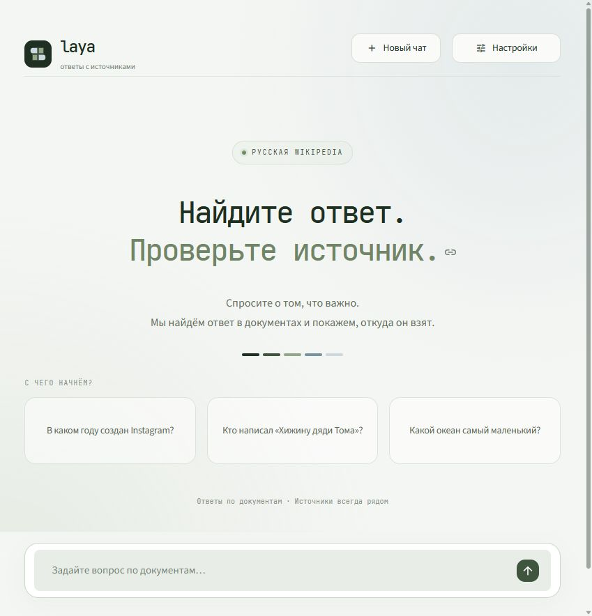
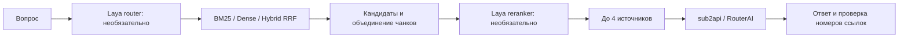
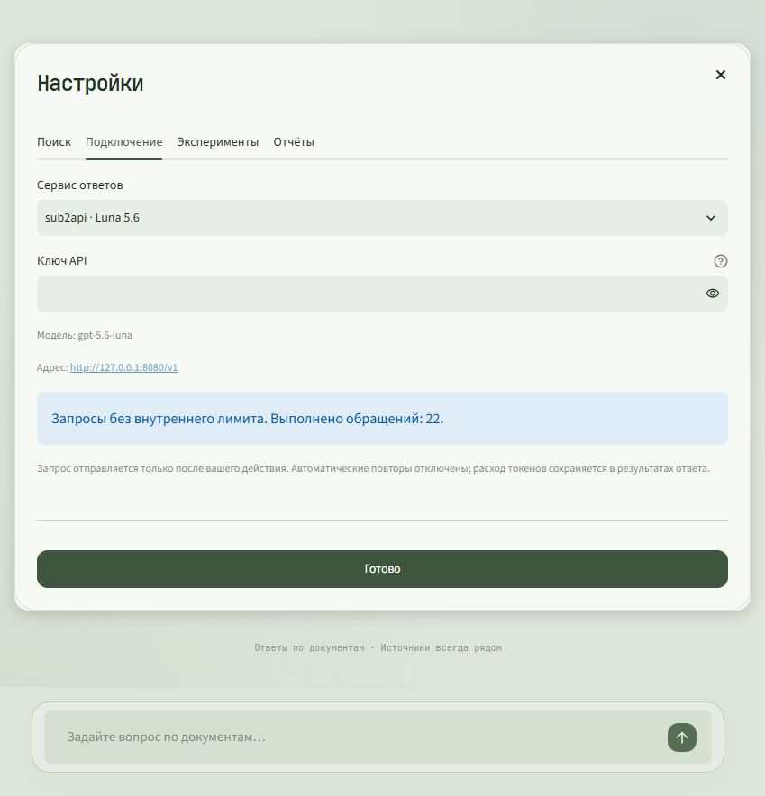
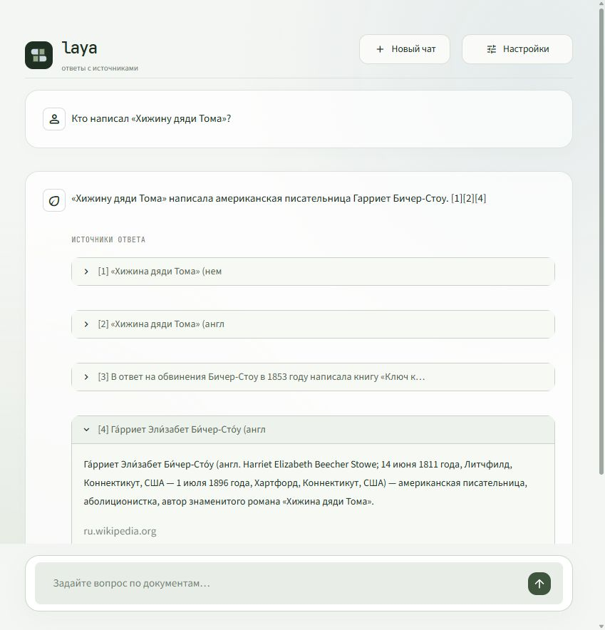

# Полный отчёт: Laya — локальный сервис ответов с источниками

**Дата:** 30 октября 2026 года, Europe/Moscow.
**Оборудование:** Intel Core i5-1235U, 10 ядер / 12 логических процессоров, 15,7 GiB RAM, Windows 11.
**Режим вычислений:** CPU, четыре потока.
**Репозиторий:** [epitaph76/RAG](https://github.com/epitaph76/RAG).
**Исходный измеренный baseline:** коммит `0f76e45`. Точные параметры, ревизии моделей, SHA данных и query IDs находятся в [benchmarks/results.json](benchmarks/results.json).

## 1. Что получилось

Создан работающий локальный веб-сервис: пользователь задаёт вопрос, система ищет подтверждающие фрагменты и получает ответ через API. Источники раскрываются под ответом и ведут к исходной публикации. Базы RuBQ и SciFact подготовлены и проиндексированы на ноутбуке; готовые индексы загружаются с диска.

В системе доступны BM25, Dense, Hybrid RRF, Laya router, Laya reranker и сочетание router + reranker. Основной генератор — `gpt-5.6-luna` через существующий sub2api; RouterAI/DeepSeek предусмотрен как дополнительный профиль. Реальные генерационные проверки проводились через sub2api.

Интерфейс переработан в сервис для диалога. Все параметры и исследовательские инструменты находятся за кнопкой «Настройки». Внутренняя API-квота снята по запросу владельца; счётчик обращений и история расходов сохранены.



## 2. Архитектура и поток данных



| Подсистема | Реализация | Назначение |
|---|---|---|
| Подготовка данных | `raglab/data.py` | Официальные источники, нормализация, проверка qrels, контрольные суммы |
| Модели | `raglab/models.py` | Ленивая загрузка на CPU, зафиксированные ревизии, локальный кеш |
| Поиск | `raglab/retrieval.py` | Чанкинг, BM25, E5, FAISS, RRF, Laya, сохранение индексов |
| Генерация | `raglab/generation.py` | OpenAI-compatible API, источники, валидация ссылок, учёт обращений |
| Оценка | `raglab/evaluation.py` | Retrieval-метрики, QA, задержки, память, JSON/CSV, checkpoint |
| Интерфейс | `app.py`, `static/service.css` | Диалог, настройки, источники, эксперименты и скачивание отчётов |
| CLI | `raglab/cli.py` | Те же функции для повторяемых запусков без браузера |

Общие типы: `Document`, `Query`, `Qrels`, `Chunk`, `Hit`, `SearchResult`, `Answer`, `Dataset`. Критическая часть retrieval не зависит от LangChain. UI и CLI используют одно ядро.

Локально работают веб-интерфейс, embeddings, sparse/dense-поиск и Laya. Генерация выполняется через API: локальный адрес sub2api является прокси и не означает, что генеративная модель исполняется на ноутбуке.

## 3. Данные и индексация

| База | Исходных документов | Чанков | Тестовых вопросов | В retrieval-оценке | Исключено без paragraph-qrels |
|---|---:|---:|---:|---:|---:|
| RuBQ 2.0 | 56 952 | 58 716 | 2 330 | 1 694 | 636 |
| BEIR SciFact | 5 183 | 7 116 | 300 | 300 | 0 |

RuBQ использует `paragraphs_uids.with_answer` как document-level qrels. Ответы, вопросы и разметка не добавляются в текст индексируемых документов. Тег `no_answer` в RuBQ относится к Wikidata и не трактуется автоматически как отсутствие ответа в текстовом корпусе.

Для SciFact используется официальное зеркало BEIR на Hugging Face. Архивный сервер BEIR в этом окружении вернул ошибку цепочки TLS; зеркало позволило загрузить те же публичные корпус и qrels без отключения проверки сертификатов. SciFact train (809 вопросов) отображается как dev; test содержит 300 вопросов. Искусственный QA F1 для SciFact не рассчитывается.

Длинные тексты разбиваются токенизатором E5 на **384 токена с перекрытием 64**. У каждого чанка сохраняются исходный document ID и URL. При расчёте метрик чанки одного документа объединяются по лучшей позиции, чтобы документ не засчитывался несколько раз.

Dense использует `intfloat/multilingual-e5-small`, префиксы `query:` / `passage:`, нормализованные FP32-векторы размерности 384 и CPU FAISS `IndexFlatIP`. BM25 индексируется через `bm25s`.

Первичный расчёт полного RuBQ занял около часа. Повторные запуски используют готовые индексы. Embeddings вычисляются батчами с группировкой по длине текста, что уменьшает padding. Строки матрицы сохраняют исходное соответствие чанкам, даже когда порядок вычисления изменён.

### Воспроизводимость и восстановление

- Данные зафиксированы ревизиями и SHA-256; manifest содержит версии библиотек, параметры, seed и ревизию embedding-модели.
- Веса скачиваются один раз; проверена повторная загрузка обеих моделей из кеша без обращения к сети.
- После каждого embedding-батча сохраняются векторы и checkpoint. Прерывание не требует пересчитывать завершённую часть.
- Готовый индекс имеет контрольные суммы файлов. Несовместимый или повреждённый индекс отклоняется. Явное перестроение создаёт чанки и векторы заново.
- На 54 560 чанках был обнаружен реальный Windows `PermissionError` при атомарной замене файла прогресса. Добавлены ограниченные повторы для WinError 5/32; при постоянной ошибке старый корректный checkpoint сохраняется. Два отдельных теста проверяют оба случая. Расчёт продолжился с сохранённого батча и был завершён.

## 4. Конфигурации поиска

Hybrid получает BM25 top-30 и Dense top-30, объединяет ранжирования через RRF с `k=60`, убирает повторения документов и выделяет первые 10 кандидатов. В генерацию передаются до четырёх источников.

Загружается один multilingual-checkpoint Laya, `max_loaded=1`, устройство CPU. Router через typed `choice` выбирает BM25, Dense или Hybrid; confidence ниже 0,6, некорректное решение или ошибка приводят к Hybrid с предупреждением. Reranker через typed `score` оценивает первые 10 кандидатов пакетами по четыре. При равных оценках сохраняется прежний порядок.

Ошибка Laya не выдаётся за успешный результат: fallback и предупреждения сохраняются по каждому вопросу. Порог router и параметры поиска после просмотра test не изменялись.

## 5. Методика оценки

Полный baseline: BM25 / Dense / Hybrid на всех размеченных test-вопросах каждого датасета. Сравнение Laya: четыре режима на одинаковых 50 вопросах каждого датасета, выбранных с `seed=42`. Полный test и подвыборки рассматриваются отдельно.

Основные показатели: Recall@5/10/20, MRR@10, nDCG@10. В таблицах ниже показаны Recall@10 и nDCG@10; остальные значения и точные query IDs доступны в JSON. Задержки p50/p95 измеряются после прогрева. Первый запрос/загрузка записаны отдельно. Пиковый RSS выборочно измеряется в процессе; Windows и Docker в него не входят.

При изменении интерфейса используются уже зафиксированные IR-результаты. Данные, модели и retrieval-параметры не менялись. Проверки интерфейса и снятия API-квоты выполнены отдельно от тяжёлого benchmark.

### Полный baseline

| Данные | Режим | N | Recall@10 | nDCG@10 | MRR@10 | p50, мс | p95, мс | RSS, GiB |
|---|---|---:|---:|---:|---:|---:|---:|---:|
| SciFact | BM25 | 300 | 0,7672 | 0,6419 | 0,6074 | 0,2 | 0,5 | 1,33 |
| SciFact | Dense | 300 | 0,7826 | 0,6693 | 0,6413 | 24,1 | 34,0 | 1,33 |
| SciFact | Hybrid | 300 | 0,8241 | 0,7044 | 0,6760 | 22,5 | 30,5 | 1,27 |
| RuBQ | BM25 | 1 694 | 0,3735 | 0,2706 | 0,2828 | 1,2 | 2,7 | 1,71 |
| RuBQ | Dense | 1 694 | 0,8111 | 0,6835 | 0,7018 | 31,2 | 38,5 | 1,66 |
| RuBQ | Hybrid | 1 694 | 0,7285 | 0,5031 | 0,4824 | 33,5 | 41,9 | 1,51 |

Hybrid оказался лучшим из трёх baseline на SciFact, а Dense — на RuBQ. Простое объединение слабого lexical-ранжирования с dense-ранжированием не гарантирует улучшение.

### Laya: одинаковые 50 вопросов на каждом датасете

| Данные | Режим | Recall@10 | nDCG@10 | MRR@10 | p50, мс | p95, мс | Fallback |
|---|---|---:|---:|---:|---:|---:|---:|
| SciFact | Hybrid | 0,7120 | 0,6512 | 0,6460 | 22,7 | 36,1 | 0% |
| SciFact | + router | 0,7120 | 0,6512 | 0,6460 | 209,8 | 259,0 | 96% |
| SciFact | + reranker | 0,7120 | 0,4269 | 0,3451 | 8 449,8 | 11 615,0 | 0% |
| SciFact | + router + reranker | 0,7120 | 0,4269 | 0,3451 | 8 198,8 | 10 954,3 | 96% |
| RuBQ | Hybrid | 0,7817 | 0,5429 | 0,5262 | 33,7 | 37,3 | 0% |
| RuBQ | + router | 0,7217 | 0,5209 | 0,5155 | 239,5 | 307,7 | 88% |
| RuBQ | + reranker | 0,7817 | 0,5613 | 0,5592 | 5 549,3 | 8 413,5 | 0% |
| RuBQ | + router + reranker | 0,7217 | 0,5177 | 0,5226 | 5 076,0 | 7 375,4 | 88% |

На RuBQ reranker повысил nDCG@10 на 0,0184 и Recall@5 с 0,5633 до 0,7067, но добавил около 5,5 с. На SciFact он ухудшил ранжирование. Router при текущем пороге часто использует fallback; на RuBQ он также снижает Recall@10 относительно постоянного Hybrid. Поэтому Laya доступна как отдельный режим для сравнения, а не обязательная стадия каждого ответа.

Одинаковый Recall@10 у Hybrid и reranker ожидаем: переупорядочиваются те же первые 10 кандидатов; состав top-10 не меняется. Польза или вред проявляются в nDCG/MRR и выборе четырёх источников для генерации.

## 6. Генерация, токены и QA

Основной профиль: `http://127.0.0.1:8080/v1`, `gpt-5.6-luna`, Chat Completions. Сервис проверен реальными ответами. Запасной профиль RouterAI настроен в приложении, но приведённые генерационные измерения относятся к sub2api.

QA smoke-test: четыре фиксированных вопроса RuBQ × четыре режима, **16 ответов**, плюс две проверки недостаточного контекста. В первом этапе вместе с первоначальным API smoke-test и проверкой чата было выполнено 20 генерационных попыток.

| Режим | EM | F1 | Входные токены | Выходные токены | p50, мс | p95, мс |
|---|---:|---:|---:|---:|---:|---:|
| Hybrid | 0,000 | 0,250 | 2 326 | 172 | 1 842,6 | 2 639,8 |
| + router | 0,000 | 0,290 | 2 353 | 137 | 2 045,5 | 3 039,0 |
| + reranker | 0,000 | 0,150 | 2 594 | 155 | 5 006,7 | 8 949,4 |
| + router + reranker | 0,000 | 0,158 | 2 539 | 140 | 5 459,0 | 9 759,6 |

Всего для 16 QA-ответов: **9 812 входных и 604 выходных токена** по данным API. Суммарный размер контекста E5 составил 1 516 / 1 540 / 1 755 / 1 708 токенов соответственно. Это оценка токенизатором E5, а не замена фактическому `usage` генератора. В данном прогоне reranker не сократил входные токены.

Обе проверки недостаточного контекста вернули ожидаемый отказ. Во всех 16 положительных QA-кейсах проверка ссылок прошла: либо использованы допустимые номера источников, либо оформлен отказ без ссылок. В двух вариантах с reranker модель отказалась отвечать на вопрос о годе создания Instagram; Hybrid ответил 2010 годом со ссылкой.

**Ограничение методики:** EM/F1 рассчитываются по полному ответу без ссылок и допустимым именам/алиасам. Поясняющие предложения снижают F1, поэтому EM=0 не означает, что каждый фактический ответ неверен. Четыре вопроса проверяют интеграцию и не дают статистически надёжной оценки семантической корректности. Номера цитат проверяются, но автоматического доказательства faithfulness каждого утверждения нет. LLM-as-judge не используется.

## 7. Обновлённый интерфейс

Основной экран содержит бренд, кнопку нового чата, кнопку настроек, примеры вопросов и поле ввода. После вопроса появляются ответ и раскрываемые источники с понятными заголовками и ссылками на статьи. Служебные scores, ID, маршруты, задержки и токены скрыты до включения диагностики.

В «Настройках» находятся четыре раздела:

1. **Поиск:** выбор базы, способ поиска, включение генерации и диагностики, подготовка/перестроение базы.
2. **Подключение:** API-провайдер, ключ в памяти сессии, модель/адрес и статистика обращений.
3. **Эксперименты:** запуск baseline, Laya и QA с сохранением checkpoint.
4. **Отчёты:** таблицы, JSON/CSV и скачивание этого полного отчёта.

Настройки сохраняются после закрытия окна. Ключи привязаны к своему провайдеру и не копируются при переключении. Открытие настроек, смена вкладок, закрытие окна и скачивание отчёта не запускают генерацию. Вопросы отправляются только после submit или явного выбора примера.

### Визуальная система

| Цвет из референса | Применение |
|---|---|
| `#0A0F09` | Самый тёмный акцент |
| `#1F2F22` | Основной текст, знак бренда |
| `#3F553E` | Кнопки и акценты |
| `#93A889` | Шалфейные детали и спокойные состояния |
| `#7993A0` | Холодный вторичный акцент |
| `#CED9DF` | Туманно-серые поверхности и декоративные элементы |

JetBrains Mono используется в бренде, заголовках и элементах интерфейса. Длинные ответы остаются в читаемом системном шрифте. WOFF2-файлы размещены локально; для открытия приложения не нужен внешний CDN шрифтов. [Лицензия OFL](static/fonts/OFL.txt) сохранена вместе с файлами. Референс использован для палитры; фотография леса не включена в приложение.



## 8. Снятие API-квоты

Внутреннего ограничения на количество обращений больше нет. `UsageLedger` считает попытки и сохраняет историю; старое имя `Budget` оставлено как совместимый Python alias. Файл `artifacts/api-budget.json` сохранён, чтобы не потерять предыдущие обращения, но поле `limit` удалено, а состояние помечено `unlimited: true`.

Старое состояние `used=20, limit=20` после миграции допускает 21-й и последующие запросы. Автотест проверяет это отдельно. Конкурентный тест подтверждает атомарность счётчика после прохождения прежней границы.

В настоящем браузере после снятия квоты выполнены **21-я и 22-я попытки** через sub2api. Первая вернула корректный отказ при недостаточном контексте на вопрос о создании Instagram; вторая назвала Гарриет Бичер-Стоу автором «Хижины дяди Тома» со ссылками `[1][2][4]`. Подтверждающий фрагмент Wikipedia раскрыт в интерфейсе. Итоговый счётчик — `used=22`, `unlimited=true`, поле `limit` отсутствует. Эти две проверки не включены в исторические benchmark-таблицы.

Команда статистики:

```powershell
.\.venv\Scripts\python.exe -m raglab.cli usage
```

Старые `budget` и `budget --add N` больше не создают квоту. Автоматические повторы SDK по-прежнему отключены. Решение продолжать или остановить работу принимает пользователь. Доступность и собственные ограничения внешнего API определяются провайдером.

## 9. Проверки качества реализации

Базовая версия прошла 24 автоматических теста. Обновлённый интерфейс и безлимитный учёт проходят **26 тестов**. Проверены:

- Соответствие документов и qrels, чанкинг и отсутствие подмешивания gold answers в индекс.
- Реальные BM25/FAISS на небольшом корпусе, сохранение, загрузка, несовместимость и восстановление повреждённого кеша.
- Продолжение embedding-батчей с сохранением соответствия строк матрицы и чанков.
- RRF, document-level метрики, нормализация QA-ответов, диапазон цитат.
- Низкая уверенность/ошибка router, пакетный reranker, стабильность равных оценок.
- Учёт ошибочных API-попыток, отсутствие автоматического повтора, redaction ошибок.
- Миграция исчерпанной квоты, обращения после старого лимита, конкурентное увеличение счётчика.
- Локальные модели без сети, переиспользование завершённых QA-кейсов.
- Скрытые настройки, один вызов генерации на submit, отсутствие вызовов при перерисовке.
- Сохранение настроек и раздельных ключей провайдеров после закрытия окна.
- Запрет второго тяжёлого задания во время фонового benchmark.
- Временная и постоянная блокировка атомарной записи JSON под Windows.

Визуальная проверка выполнена в настоящем браузере: главный экран, окно настроек, смена режима и возврат в диалог, ответ с раскрытым источником, очистка истории через «Новый чат». Полный отчёт и файлы CSV/JSON успешно скачаны через «Настройки → Отчёты»; счётчик API при этих действиях остался равен 22. HTTP-проверка подтвердила доступность сервиса и локального шрифта: HTTP 200, `Content-Type: font/woff2`. Скриншоты главного экрана, настроек и ответа находятся в `docs/`.



## 10. Что сохранено и что публикуется

В GitHub публикуются код, зафиксированные зависимости, инструкции, этот отчёт, числовые агрегаты, query IDs, шрифты с лицензией и снимки интерфейса. Исходные корпуса, веса моделей, индексы, runtime checkpoint, журналы обращений и реальные ключи остаются локально и исключены из Git.

Секреты читаются из переменных окружения либо хранятся только в памяти сессии. Ключ не включается в prompt, manifest, публичные отчёты или сообщения об ошибках. Перед push публикуемые файлы проверяются на отсутствие предоставленного API-ключа.

## 11. Запуск и повторение результатов

```powershell
.\start.ps1
```

Веб-приложение: [127.0.0.1:8501](http://127.0.0.1:8501). Для восстановления окружения — `start.ps1 -Install`. Полный локальный benchmark — `python -m raglab.cli benchmark`, отдельный датасет — `benchmark --dataset rubq`. QA — `python -m raglab.cli qa --dataset rubq --profile sub2api`.

Вопросы в текущей версии независимы от истории. Пользовательские документы, Jev, GraphRAG, agentic-циклы, ONNX и обучение моделей относятся к следующим этапам. Текущая версия рассчитана на одного пользователя и запускается только на loopback.

## 12. Выводы

Проект даёт воспроизводимый способ сравнить поиск, локальные решения Laya и генерацию через API на доступном ноутбуке. Лучший baseline зависит от корпуса: Hybrid выиграл на SciFact, Dense — на RuBQ. Laya reranker дал небольшой выигрыш ранжирования на русской подвыборке ценой нескольких секунд и ухудшил SciFact. Router в текущей zero-shot-конфигурации не показал преимущества над постоянным Hybrid.

Главный практический результат — работающий сервис с сохранёнными индексами и проверяемыми источниками, а также опубликованные измерения, позволяющие выбирать режим по данным. Следующие улучшения качества следует проверять на dev-выборке и сравнивать с этими зафиксированными baseline.

### Источники

[RuBQ 2.0](https://github.com/vladislavneon/RuBQ/tree/master/RuBQ_2.0), [BEIR SciFact](https://huggingface.co/datasets/BeIR/scifact), [SciFact qrels](https://huggingface.co/datasets/BeIR/scifact-qrels), [Multilingual E5](https://huggingface.co/intfloat/multilingual-e5-small), [Laya](https://github.com/NandhaKishorM/laya), [JetBrains Mono](https://github.com/JetBrains/JetBrainsMono), [статические ресурсы Streamlit](https://docs.streamlit.io/develop/concepts/configuration/serving-static-files). Корпуса распространяются с атрибуцией CC BY-SA 4.0; шрифт — с сохранённой OFL.
