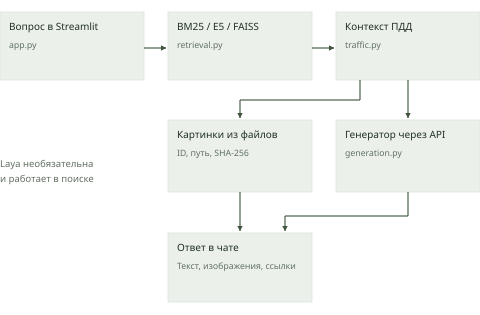
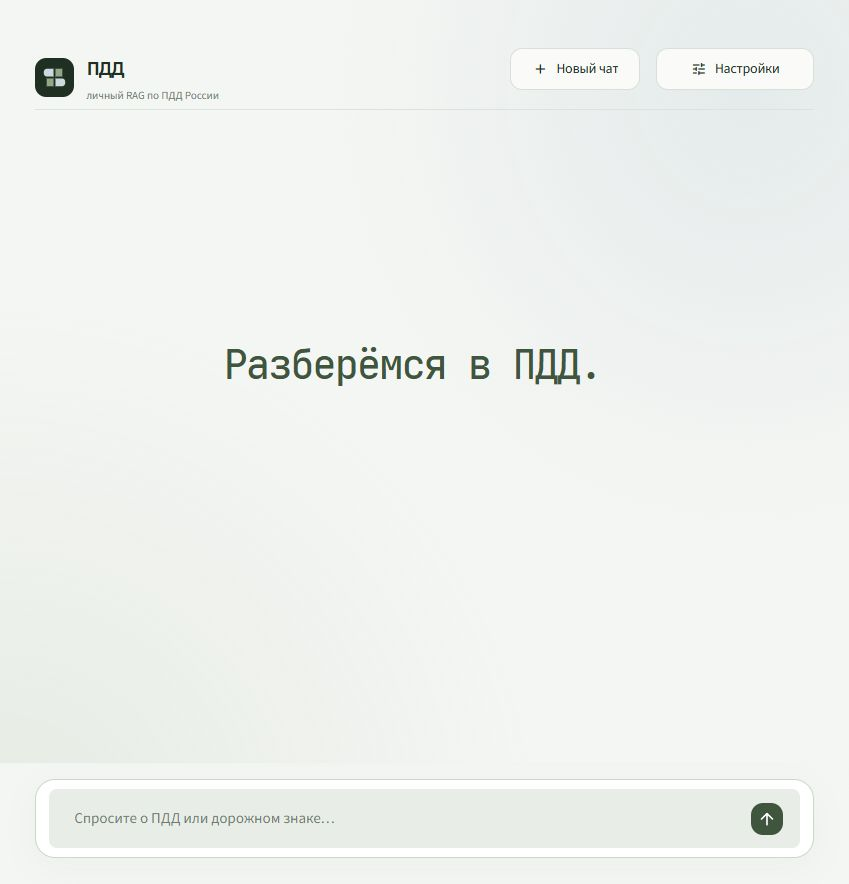
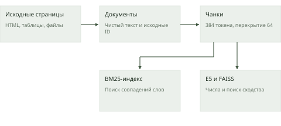
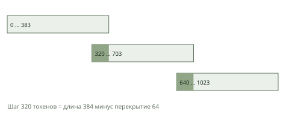
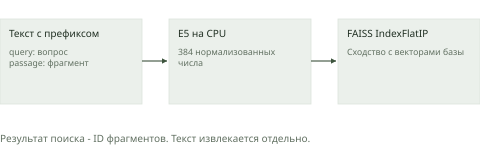
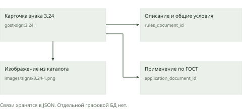
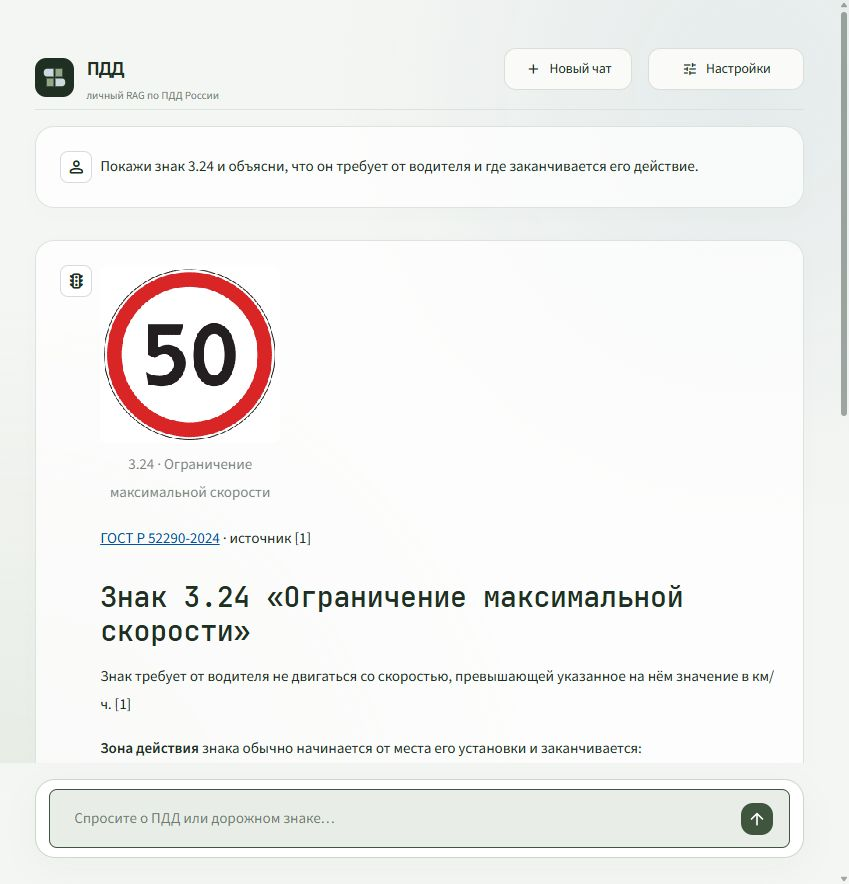
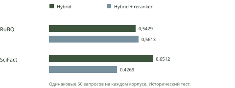
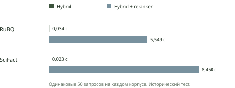
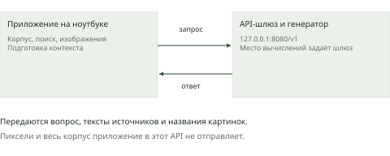

# Личный RAG по ПДД России

Подробный технический отчёт. 31.10.2026. Срез реализации a0d2926.

# Коротко о проекте

Этот отчёт объясняет устройство личного помощника по Правилам дорожного движения России. Приложение принимает вопрос, находит подходящие фрагменты в сохранённой базе, передаёт их языковой модели и показывает ответ вместе с источниками. Если вопрос относится к дорожному знаку, приложение может вывести его эталонное изображение и, по просьбе пользователя, связанные фотографии из своего каталога.

Главная идея проекта - разделить **поиск материала** и **формулирование ответа**. Поисковая часть выбирает документы. Языковая модель объясняет переданный текст. Специальный модуль связывает номер знака с его изображением, описанием, общими условиями и правилами применения. Такое устройство позволяет проверять, откуда взялось объяснение, и заменять части системы по отдельности.

Отчёт описывает код в состоянии коммита `a0d2926` и нормативный снимок от 30 октября 2026 года. Он не утверждает, что законодательство автоматически обновляется при каждом вопросе. Числа ниже взяты из сохранённых manifest, индексов и результатов проверок. Условные примеры алгоритмов отдельно отмечены в тексте.

| Характеристика | Реальное состояние проекта |
|---|---|
| Рабочая база | ПДД России и связанные нормативные материалы |
| Нормализованные документы | 1 164 |
| Фрагменты в поисковом индексе | 1 564 |
| Эталонные изображения знаков | 308 |
| Исторические фотографии | 432 |
| Размер одного смыслового вектора | 384 числа |
| Режим по умолчанию | Hybrid: BM25, Dense и объединение RRF |
| Основной генератор | gpt-5.6-luna через существующий sub2api |
| Веб-интерфейс | Streamlit, адрес 127.0.0.1:8501 |
| Проверки реализации | 42 теста, проверка 547 исходных файлов и 740 изображений |

**Ответ на вопрос «какая здесь БД»:** отдельного сервера базы данных в этой версии нет. Тексты и связи находятся в JSON/JSONL, картинки лежат в файлах, BM25 хранит индекс слов, FAISS хранит индекс векторов. Приложение загружает эти структуры в память. Это файловое хранилище с поисковыми индексами, рассчитанное на одного локального пользователя.

**Ответ на вопрос о Laya:** в ранних экспериментах reranker немного улучшил ранжирование RuBQ, но замедлил поиск до нескольких секунд и ухудшил SciFact. Router общего выигрыша не показал. Для ПДД независимого benchmark пока нет. Поэтому Laya доступна как дополнительная настройка, а обычный Hybrid остаётся режимом по умолчанию.

## Как читать отчёт

Главы 1 и 2 объясняют RAG и общую архитектуру. Главы 3 и 4 подробно разбирают данные, хранение и поиск. В главах 5-7 описаны дорожные знаки, Laya и генерация через API. Главы 8-10 посвящены работе на ноутбуке, проверкам и эксплуатации. В приложениях собраны версии технологий, словарь терминов и ссылки на первичные источники.

Отдельно различаются факты о реализации, измеренные результаты и возможные будущие улучшения. Например, размер матрицы векторов измерен в файле, результаты Laya относятся к прежним тестовым корпусам, а ожидаемая польза нового алгоритма для ПДД требует собственного эксперимента.

Основные материалы проекта: [код и README](https://github.com/epitaph76/RAG/tree/a0d2926), [отчёт о версии ПДД](https://github.com/epitaph76/RAG/blob/a0d2926/docs/PDD_SERVICE.md), [машинный результат проверки](https://github.com/epitaph76/RAG/blob/a0d2926/benchmarks/validation-pdd.json).

# 1. Что такое RAG

## 1.1. Задача, которую решает система

Представим вопрос: «Покажи знак 3.24 и объясни, где заканчивается его действие». Чтобы ответить, нужно найти определение знака, общие правила его действия и подходящую картинку. Одного совпадения номера недостаточно: условия могут находиться в другой части приложения к ПДД, а изображение - в отдельном каталоге.

Человек мог бы открыть несколько документов, сопоставить их и написать объяснение. Наше приложение автоматизирует эту последовательность. Оно сначала подбирает материал, а затем просит языковую модель подготовить понятный ответ. Пользователь получает не только текст, но и возможность раскрыть использованные фрагменты.

Языковая модель умеет продолжать и преобразовывать текст, опираясь на закономерности, усвоенные при обучении. Однако её уверенный стиль не гарантирует, что конкретный факт соответствует нужной редакции документа. В проекте модель получает дополнительный рабочий материал непосредственно перед ответом. Этот материал и называется контекстом запроса.

## 1.2. Расшифровка RAG

RAG означает Retrieval-Augmented Generation: генерация, дополненная поиском. Retrieval - поиск подходящего материала. Augmented - добавление этого материала к запросу модели. Generation - создание текста ответа. Историческую формулировку подхода описывает работа Lewis и соавторов; наш проект использует собственную прикладную цепочку с готовыми моделями и файловым корпусом.


Рисунок 1. Принцип RAG: поиск материала перед подготовкой ответа

Полезная аналогия - подготовка ответа с открытой книгой. Поисковая часть находит нужные страницы, а генератор составляет объяснение по найденному. Если поисковик принёс неподходящий материал, хорошее владение языком само по себе не исправит проблему. Поэтому качество поиска и качество ответа нужно проверять отдельно.

RAG не требует обучать большую модель заново при каждом изменении базы. В нашей версии добавление или обновление документов меняет корпус и поисковые индексы. Веса E5, Laya и языковой модели при этом не обучаются. Это делает локальные обновления гораздо проще, хотя корректность новых источников всё равно нужно проверить.

## 1.3. Документ, фрагмент, вектор и контекст

**Документ** - самостоятельная запись корпуса с ID, текстом, названием и ссылкой. Документом может быть пункт ПДД, статья КоАП или карточка знака. **Фрагмент**, или чанк, - часть документа, удобная для поиска. Длинный текст разбивается на несколько таких частей.

**Вектор**, или embedding, - набор чисел, который модель E5 вычисляет из текста. По этим числам можно искать похожие по смыслу фрагменты. Числа не заменяют исходный текст: после поиска приложение использует ID, чтобы вернуть человеку читаемый материал.

**Контекст ответа** - небольшой набор источников, который приложение реально отправляет генератору. Поисковый индекс может содержать тысячи фрагментов, но в один ответ попадают до четырёх источников. Для ПДД эти источники могут быть специально собраны из полной карточки и связанных нормативных абзацев.

## 1.4. Что RAG улучшает и где остаются ошибки

RAG позволяет опираться на собственный корпус, показывать происхождение информации и обновлять знания через данные. Он также делает проблемы более заметными: можно увидеть, какой документ система нашла и на что сослалась модель.

Ошибки всё ещё возможны на каждом этапе. В исходном корпусе может отсутствовать нужная редакция. Поиск может выбрать похожий, но неверный пункт. В контекст может не попасть важное исключение. Генератор может неверно обобщить переданные условия. Проверка номера ссылки не доказывает, что каждое утверждение следует из источника.

Поэтому RAG полезно понимать как управляемый процесс работы с материалом. Надёжность зависит от происхождения документов, полноты связей, качества ранжирования, правил генерации и проверки результата. В этом проекте эти части реализованы раздельно, чтобы их можно было исследовать и улучшать независимо.

Первичный источник понятия: [Retrieval-Augmented Generation, Lewis et al.](https://arxiv.org/abs/2005.11401). Применение в нашем коде: [app.py](https://github.com/epitaph76/RAG/blob/a0d2926/app.py).

# 2. Архитектура приложения

## 2.1. Компоненты и их обязанности

В центре системы находится общее Python-ядро. Веб-интерфейс и команды терминала используют одни и те же функции подготовки данных, индексации, поиска и генерации. Благодаря этому пользовательский чат не живёт отдельной жизнью относительно проверочных скриптов.

Веб-интерфейс работает через Streamlit. Он принимает вопрос, вызывает поиск, собирает источники ПДД, обращается к генератору и выводит результат. В файле `app.py` находятся элементы страницы и управление сессией. Алгоритмы поиска и проверки изображений вынесены в модули `raglab`, чтобы их можно было проверять без браузера.



Рисунок 2. Архитектура личного RAG по ПДД и основные модули

| Модуль | Основная ответственность |
|---|---|
| `pdd.py` | Сборка и проверка нормативного корпуса и изображений |
| `data.py`, `types.py` | Загрузка данных и общие типы объектов |
| `models.py` | Загрузка локальных E5 и Laya, фиксация ревизий |
| `retrieval.py` | Разбиение, BM25, Dense, RRF, router и reranker |
| `traffic.py` | Связи знаков, нормативные фрагменты, выбор изображений |
| `generation.py` | API-запрос, правила ответа, ссылки и учёт попыток |
| `storage.py` | JSON, контрольные суммы и атомарная запись |
| `cli.py` | Подготовка, индекс, вопрос, проверка и статистика из терминала |

## 2.2. Два разных жизненных цикла

Первый цикл - подготовка базы. Программа скачивает и разбирает исходники, сохраняет документы, вычисляет embeddings и строит индексы. Это относительно дорогая работа. Она выполняется при первом запуске или явном обновлении и оставляет результаты на диске.

Второй цикл - обработка вопроса. Приложение использует готовые индексы. Для Dense оно вычисляет вектор только нового вопроса. Из найденных материалов собирается контекст, после чего выполняется API-вызов. Пересчитывать весь корпус ради одного вопроса не требуется.

Сохранённый индекс помогает и после перезагрузки компьютера. Процесс снова загружает модель и структуры из файлов. Загрузка библиотек и весов может занять время при холодном старте, но это отличается от полной повторной индексации. В проверке после перезагрузки приложение использовало прежний manifest индекса от 30.10.2026.

## 2.3. Один вопрос от начала до конца

После отправки вопроса `Index.retrieve` выполняет выбранный поиск. По умолчанию BM25 ищет совпадения слов, Dense ищет смысловое сходство, а RRF объединяет результаты. При включённой Laya router может выбрать маршрут, а reranker может изменить порядок кандидатов.

Далее `TrafficKnowledge.sources` учитывает предметную область. Если пользователь указал точный номер или название знака, модуль находит карточку и связанные правила по ID. Он добавляет описание, подходящие общие условия и материал о применении знака. Такое дополнение особенно важно, потому что короткий найденный чанк может не содержать исключения из другого абзаца.

Генератор получает вопрос и пронумерованные источники. Изображения приложение выбирает отдельно по каталогу. После ответа интерфейс показывает текст, исходные PNG или фото и раскрываемые фрагменты. При включённой диагностике видны маршрут, время стадий и расход токенов API.

## 2.4. Локальная часть и API

Локально работают корпус, изображения, BM25, E5, FAISS, необязательная Laya и интерфейс. Генерация текста использует API. Основной профиль обращается к `http://127.0.0.1:8080/v1`, где уже существует sub2api. Это адрес шлюза на компьютере. Код RAG не определяет, где физически выполняется большая языковая модель за этим шлюзом.

Поэтому формулировка «локальное приложение» относится к самому сервису и поисковой части. Она не означает, что `gpt-5.6-luna` обязательно загружается в память этого ноутбука. Резервный профиль RouterAI также является API-подключением. Провайдер выбирается вручную, автоматического переключения нет.

## 2.5. Текущее устройство пользовательского сервиса

На главном экране остались фраза «Разберёмся в ПДД», поле вопроса и кнопки нового чата и настроек. В настройках находятся способ поиска, подключение API и сведения о базе. RuBQ и SciFact убраны из рабочего интерфейса и CLI. Их прежние данные и индексы перенесены в локальный архив, а результаты исследований сохранены в GitHub.

История нужна для отображения уже полученных ответов. Каждый новый вопрос обрабатывается независимо: прошлый диалог не добавляется в запрос генератора. Система пока не предназначена для полноценного разговора, где фраза «а этот знак?» автоматически ссылается на предыдущее сообщение.



Состояние интерфейса относится к сессии. Перезапуск процесса очищает историю и введённые в интерфейсе ключи. Корпус, изображения и индексы остаются на диске. Это простая модель работы для одного пользователя, которая не требует аккаунтов, многопользовательской БД или отдельного сервера авторизации.

# 3. Данные и хранение

## 3.1. Состав корпуса ПДД

В рабочем наборе находится 1 164 нормализованных документа. Слово «документ» здесь означает запись для поиска, а не обязательно целый закон или исходную веб-страницу. Одна нормативная страница может дать много записей: отдельные пункты, статьи и карточки знаков.

| Группа записей | Количество | Содержание |
|---|---|---|
| Пункты ПДД | 195 | Материал всех 26 разделов |
| Группы знаков и разметка | 10 | 8 групп знаков, 2 записи разметки |
| Постановление, допуск и неисправности | 116 | 7, 23 и 86 записей соответственно |
| КоАП и УК | 60 | 53 связанные статьи КоАП и 7 записей УК |
| Безопасность движения и ОСАГО | 71 | 33 и 38 записей законов |
| Применение по ГОСТ | 404 | Разделы, пункты и таблицы ГОСТ Р 52289-2019 |
| Карточки знаков | 308 | Название, описание и связи с изображениями |

308 эталонных изображений соответствуют 308 кодам каталога. Дополнительно сохранены 432 исторических фото-фрагмента, относящиеся к 125 кодам. Фото помогают показать внешний вид на дороге, но сами по себе не являются доказательством действующей нормы. Полный исходный фотодатасет RTSD в сохранённом parquet содержит 104 358 записей; в интерфейс выбирается небольшой связанный набор изображений.

## 3.2. Происхождение и редакции

Корпус собран 30.10.2026. Консолидированная редакция ПДД в источнике датирована 28.08.2026, КоАП - 04.08.2026. Для изображений используется каталог ГОСТ Р 52290-2024. Материал о применении знаков относится к ГОСТ Р 52289-2019 с редакцией, указанной источником как 22.07.2025. Дата скачивания и дата редакции - разные поля.

Консолидированные тексты получены из открытых публикаций КонсультантПлюс. Изображения извлечены из опубликованного приложения к стандарту, сведения о стандартах сверялись с карточками Росстандарта. В manifest сохранено ограничение: официальная публикация одного из последних изменений ПДД не ответила при сборке, поэтому независимая сверка этого файла осталась неполной.

Это важная характеристика происхождения данных. Система отвечает по сохранённому снимку. Она не устанавливает автоматически, что текст полностью совпадает с правовым состоянием на любую последующую дату. При обновлении нужно проверить новые редакции, сроки вступления изменений в силу и полноту связей.

## 3.3. Requests и BeautifulSoup

**Requests** выполняет HTTP-загрузку: обращается по URL, получает байты ответа и проверяет код состояния. Сборщик задаёт таймауты, сохраняет оригинал и отдельные сведения о загрузке. В них входят исходный и итоговый адрес, фактическое время, MIME-тип и SHA-256 содержимого. Повторный запуск может использовать уже сохранённый и проверенный файл.

**BeautifulSoup** разбирает HTML в структуру элементов. Так программа находит текст нормативного блока, ссылки, заголовки и таблицы. HTML-страница содержит не только нормы, но и меню, навигацию, редакционные заметки и техническую разметку. Сборщик отделяет их от содержательного материала.

Для правовых данных особенно важно сохранить рабочие сноски и корректно раскрыть таблицы с объединёнными ячейками. Ошибка здесь может привязать название к неправильному коду знака или удалить условие применения. В тестах отдельно проверяются нормативные сноски, таблицы с rowspan/colspan, признаки CAPTCHA и отличие определения знака от абзаца об исключении.



Рисунок 4. Подготовка поисковых индексов до вопросов пользователя

## 3.4. JSON, JSONL и общие типы

**JSON** - текстовый формат структурированных данных. Вместо произвольного документа он хранит поля и значения: например, ID, текст, название и URL. Его удобно читать программой и проверять вручную. В проекте Python-модуль `json` превращает такие записи в словари и обратно.

**JSONL** использует одну JSON-запись на строку. Это удобно для набора независимых документов или изображений. Можно обработать записи по очереди, сохранить происхождение каждой и сравнить конкретные строки при обновлении. Файл `dataset.json` даёт унифицированный набор для ядра, а богатые JSONL сохраняют дополнительные сведения об источниках и связях.

Общий тип `Document` содержит `id`, `text`, `title`, `url`. Чанк хранит собственный `id` и исходный `document_id`. `Hit` объединяет чанк с поисковой оценкой. `SearchResult` содержит найденные записи, маршрут и задержки. `Answer` хранит ответ, ссылки и расход API. Это обычные Python dataclass, которые делают границы модулей понятными.

В ядре также остались типы `Query` и `Qrels` для исторических экспериментов. Qrels - эталонная разметка связи вопроса и релевантных документов. Для ПДД такой независимой разметки пока нет. Наличие этих типов в коде не означает, что уже измерена точность поиска на новом корпусе.

## 3.5. Что именно заменяет сервер БД

Файловое хранилище разделено по назначению. Текстовые записи отвечают на вопрос «что написано в источнике». Индексы отвечают на вопрос «как быстро найти подходящие записи». Каталоги изображений отвечают на вопрос «какой файл связан с этим кодом». Приложение соединяет результаты через ID.

| Файл или каталог | Для чего нужен |
|---|---|
| `dataset.json` | Нормализованные документы для Python-ядра |
| `corpus.jsonl` | Расширенные записи: вид документа, редакция, статус и происхождение |
| `signs.jsonl` | Коды знаков, изображения и связанные нормы |
| `photos.jsonl` | Фотографии, классы RTSD, хеши и происхождение |
| `sources.json` | Источники и сведения о скачивании |
| `images/` | Локальные PNG и JPEG |
| `chunks.json` | Тексты фрагментов и связь с исходными документами |
| `bm25/` | Индекс совпадений слов |
| `embeddings.npy` | Матрица смысловых векторов |
| `dense.faiss` | Индекс FAISS для векторного поиска |
| `manifest.json` | Параметры и контрольные суммы набора или индекса |

FAISS здесь является библиотекой поиска по векторам. Он не заменяет весь корпус и не хранит всю бизнес-логику. После получения номера строки из FAISS программа обращается к соответствующему чанку. Из текста и метаданных она получает название и исходную ссылку.

PostgreSQL, SQLite, Qdrant и отдельная графовая БД в текущем приложении не используются. Для небольшого локального корпуса это позволяет обходиться одним Python-процессом и файлами. При нескольких пользователях, частых конкурентных обновлениях и сложных фильтрах потребуется заново оценить такую архитектуру.

## 3.6. Parquet, PyArrow и Pillow

Parquet - двоичный табличный формат с хранением по столбцам. В проекте он используется как формат исходного фотодатасета. **PyArrow** читает таблицу и позволяет извлечь байты изображений и сопутствующие поля. Это этап подготовки данных, а не отдельный SQL-сервер в чате.

**Pillow** открывает изображения, проверяет их чтение, получает размеры и помогает сохранить выбранные фото. При сборке отбрасываются слишком маленькие и повторяющиеся кадры, а выборка связывается с кодами знаков. Во время проверки корпуса Pillow помогает убедиться, что изображение действительно декодируется, а не просто существует под именем `.png`.

Число файлов и их хеши позволяют обнаружить потерю или изменение сохранённых данных. Они не доказывают полноту законодательства. Эта разница между технической целостностью и содержательной полнотой будет важна также в главе о тестировании.

Источники реализации: [сборщик ПДД](https://github.com/epitaph76/RAG/blob/a0d2926/raglab/pdd.py), [карточка корпуса](https://github.com/epitaph76/RAG/blob/a0d2926/docs/PDD_DATASET.md). Форматы: [Python JSON](https://docs.python.org/3.12/library/json.html), [PyArrow Parquet](https://arrow.apache.org/docs/python/generated/pyarrow.parquet.read_table.html).

# 4. Как работает поиск

## 4.1. Зачем делить документы на фрагменты

Длинный документ может одновременно описывать много разных правил. Если искать по нему как по одному целому, совпадение нужного абзаца смешается с остальным текстом. Кроме того, у моделей есть ограничение на длину входа. Поэтому индексатор создаёт более короткие поисковые фрагменты.

В проекте размер окна равен **384 токенам**, перекрытие соседних окон - **64 токена**. Следующее окно начинается через 320 токенов после предыдущего. Перекрытие сохраняет часть соседнего контекста около границы. Если определение оказалось в конце одного окна, его продолжение с большей вероятностью останется рядом хотя бы в другом окне.



Рисунок 5. Окна токенов с перекрытием. Позиции приведены для объяснения алгоритма

Токен - единица, на которую токенизатор разбивает текст для модели. Это может быть слово, часть слова или знак. 384 токена нельзя надёжно заменить правилом «384 слова». Для русского текста длина зависит от конкретных слов и токенизатора. Индексатор использует токенизатор E5, а не считает символы.

Каждый фрагмент сохраняет `document_id`, название и URL исходного документа. При объединении результатов система оставляет лучший найденный фрагмент одного документа. Это уменьшает ситуацию, когда несколько соседних окон одной статьи занимают все первые позиции.

384/64 - параметры индексации. Финальный контекст ПДД может включать полную карточку или выборку связанных абзацев. Следовательно, «до четырёх источников» не означает жёсткое ограничение «четыре раза по 384 токена». Размер входа генератора нужно смотреть по его фактическому `usage`.

## 4.2. Поиск по словам: BM25

BM25 оценивает, насколько слова вопроса соответствуют словам документа. Условно, если человек спрашивает об «ограничении максимальной скорости», фрагмент с этими словами получает основания оказаться выше фрагмента на другую тему. Алгоритм также учитывает, насколько часто слово встречается в самом корпусе и насколько велик документ.

Редкое слово обычно лучше различает документы, чем слово, встречающееся почти везде. Повторение полезного слова помогает, но не даёт бесконечного преимущества: вклад частоты насыщается. Поправка на длину уменьшает автоматическое преимущество большого текста, в который попало много разных слов.

Для читателя без математической подготовки это можно представить как оценку по трём признакам: есть ли нужное совпадение, насколько оно характерно и не объясняется ли оно просто объёмом документа. Результат BM25 - число для сортировки. Это не процент уверенности в правильности ответа.

| Свойство | Практический смысл |
|---|---|
| Совпадения терминов | Полезны при точных названиях и устойчивых формулировках |
| Частота в документе | Повторение поддерживает релевантность с убывающей отдачей |
| Редкость в корпусе | Более различающее слово получает больший вес |
| Учёт длины | Большой текст не должен выигрывать только из-за размера |

Библиотека **bm25s** реализует такой поиск через заранее подготовленные разреженные структуры и числовые операции. Большая часть работы выполняется во время индексации. При вопросе программа использует готовый индекс и получает первые результаты, не перечитывая все тексты с нуля.

В нашей реализации BM25 возвращает до 30 чанков. Токенизация идёт без списка стоп-слов. Отдельный русский морфологический анализ или лемматизация не подключены. Поэтому разные формы слова и перефразировки могут снижать пользу буквального поиска. Именно для таких случаев рядом работает Dense.

## 4.3. Смысловой поиск: Dense

Dense означает поиск по плотным векторам. Модель преобразует текст в набор чисел, а система сравнивает такие наборы. Это помогает находить материалы, в которых вопрос и источник выражают близкую мысль разными словами. Например, формулировки «где нельзя оставлять машину» и «стоянка запрещена» могут быть близки по смыслу без полного совпадения слов.

Отдельное число в векторе обычно не имеет простого человеческого названия вроде «скорость» или «парковка». Значение имеет совместное расположение всех чисел. Модель получила это представление при своём предварительном обучении. Наш проект использует готовую модель и не обучает её на правилах дорожного движения.



Рисунок 6. Смысловой поиск: E5 превращает текст в числа, FAISS находит сходство

Смысловое сходство тоже может ошибаться. Два текста про остановку могут быть близки по теме, хотя один её разрешает, а другой запрещает. Близкие номера знаков и похожие исключения также требуют осторожности. Векторная оценка показывает сходство представлений, а не юридическую истинность найденного утверждения.

## 4.4. E5 и Sentence Transformers

Для embeddings используется `intfloat/multilingual-e5-small`. Модель поддерживает многоязычный текст и возвращает вектор из **384 чисел**. В нашем коде перед вопросом ставится префикс `query:`, а перед фрагментом - `passage:`. Эти роли соответствуют инструкции модели, в том числе когда сам текст написан по-русски.

**Sentence Transformers** предоставляет готовую обвязку для получения одного вектора из текста. Она запускает токенизатор и модель, объединяет представления токенов согласно конфигурации checkpoint и возвращает массив чисел. Приложение вызывает `encode`, а не реализует слои нейросети вручную.

Векторы нормализуются: их длина приводится к единице. Для нормализованных векторов скалярное произведение соответствует косинусному сходству. Поэтому FAISS может сравнивать направления представлений через `IndexFlatIP`. Максимальная длина входа encoder в коде установлена в 512 токенов, а индексируемые окна заметно короче.

Вопрос кодируется той же моделью и с той же размерностью, что и корпус. Смешивать старые векторы одной модели с вопросами другой нельзя: одинаковое число координат само по себе не делает пространства совместимыми. Поэтому ревизия embedding-модели входит в идентичность индекса.

## 4.5. FAISS IndexFlatIP

**FAISS** ищет похожие векторы. Выбранный тип `IndexFlatIP` хранит векторы без приближённого разбиения на кластеры и сравнивает вопрос со всеми сохранёнными строками. Flat означает прямой перебор, IP - inner product, скалярное произведение. В текущем небольшом корпусе такой подход прост и достаточен по объёму данных.

Поиск возвращает номера строк и их числовые оценки. Программа связывает строки с чанками, после чего получает исходный текст. В реализации нет HNSW, IVF или сжатия PQ. Эти способы могут быть полезны на значительно больших корпусах, но здесь они не задействованы.

Матрица содержит 1 564 строки по 384 числа типа float32. Каждое число занимает 4 байта. Объём самих векторов равен 1 564 × 384 × 4 = **2 402 304 байта**, около **2,29 MiB**. Размер файла `dense.faiss` чуть больше из-за служебной информации. Это не объём всей памяти приложения: отдельно загружаются модели, библиотеки, тексты и другие структуры.

## 4.6. NumPy и продолжение индексации

**NumPy** хранит и обрабатывает числовые массивы. Формат `.npy` сохраняет матрицу вместе с её размерностью и типом данных. `open_memmap` позволяет работать с массивом через файл: записывать рассчитанные части и продолжать работу после остановки, не начиная весь расчёт заново.

Embeddings вычисляются пакетами по 32 текста. После пакета программа сохраняет завершённую позицию. Чтобы уменьшать пустое дополнение коротких текстов до длины длинного соседа, она группирует задания по длине. При этом сохраняет соответствие между строкой матрицы и исходным чанком. Файл порядка обработки отдельно фиксирует выполнение этой перестановки.

Возобновление допускается только при совместимой идентичности незавершённой работы. Если изменились данные, параметры или важные версии библиотек, старый результат не должен незаметно смешаться с новым. Эта проверка важнее, чем простая проверка существования файла на диске.

## 4.7. Hybrid и Reciprocal Rank Fusion

Hybrid объединяет BM25 и Dense. Один канал хорошо реагирует на буквальные совпадения, другой помогает с перефразировками. Их исходные оценки имеют разные шкалы, поэтому простая сумма чисел могла бы дать преимущество одной шкале без содержательной причины.

**RRF**, Reciprocal Rank Fusion, объединяет позиции. Каждому результату начисляется вклад `1 / (60 + позиция)` из каждого списка, в котором он присутствует. Затем вклады складываются. Число 60 здесь - фиксированный параметр RRF, а не число окончательных источников.

```text
RRF(запись) = сумма по каналам 1 / (60 + позиция)
```

Условный пример ниже объясняет формулу и не является измерением ПДД. Для простоты каждая запись представлена одним чанком.

| Запись | Место BM25 | Место Dense | Сумма RRF |
|---|---|---|---|
| А | 1 | 9 | 0,03089 |
| Б | 4 | 1 | 0,03202 |
| В | 2 | 15 | 0,02946 |

Запись Б выигрывает, потому что имеет хорошие позиции в обоих списках. Алгоритму не нужно знать, что означает сырая оценка BM25 относительно сырой оценки Dense. Однако такое объединение не гарантирует улучшения: слабый канал может ухудшить итог. Исторические измерения проекта это подтверждают.

В коде объединяются до 30 результатов каждого канала. До удаления повторов это не более 60 чанков. RRF сначала работает с ID чанков, затем система объединяет попадания одного документа по лучшей итоговой позиции. Для необязательного reranker берутся первые 10 документов. Финальный модуль ПДД собирает до четырёх источников для ответа и может дополнить их точными связями каталога.

Реализация: [retrieval.py](https://github.com/epitaph76/RAG/blob/a0d2926/raglab/retrieval.py). Первичные описания: [BM25S](https://github.com/xhluca/bm25s), [E5](https://huggingface.co/intfloat/multilingual-e5-small), [FAISS](https://github.com/facebookresearch/faiss/wiki/Getting-started), [NumPy memmap](https://numpy.org/doc/stable/reference/generated/numpy.lib.format.open_memmap.html), [работа о RRF](https://cormack.uwaterloo.ca/cormacksigir09-rrf.pdf).

# 5. Предметная логика ПДД и изображения

## 5.1. Зачем нужен отдельный модуль

Обычный текстовый поиск не знает, что номер 3.24 должен вести к конкретному изображению. Он также не гарантирует, что вместе с определением попадёт общий абзац о зоне действия. Для этой задачи в проекте есть `TrafficKnowledge`: небольшой слой предметных правил поверх поисковых результатов.

Модуль распознаёт явно указанный номер знака или точное нормализованное название. Он различает вопрос о знаке и ссылку на пункт нормативного акта. Например, формулировка «объясни пункт 3.27» сама по себе не превращает пункт в дорожный знак. Голый номер вроде «3.27?» разрешён как запрос к каталогу.

Нормализация названий приводит регистр и заменяет «ё» на «е», убирает лишнюю пунктуацию и пробелы. Это не универсальное понимание всех вариантов русского языка. При свободной перефразировке основную работу продолжает выполнять смысловой поиск.

## 5.2. Связи по ID

В записи каталога есть ID карточки, код, название, путь к изображению, SHA-256 и ссылки на связанные документы. `rules_document_id` указывает на группу ПДД с общими условиями. `application_document_id` указывает на материал ГОСТ о применении. Так программа может собрать несколько относящихся к знаку источников.



Рисунок 7. Связи карточки знака с правилами и изображением

Сначала добавляются карточки запрошенных знаков. Затем выбираются связанные абзацы общих правил, включая упоминания диапазонов кодов. Например, правило о диапазоне 3.27-3.30 может относиться к запрошенному 3.28. Проверка учитывает структуру номера и не должна принимать префикс 3.2 за полный код 3.24.

При выборе абзацев сохраняется вводящий заголовок, например «Действие знаков не распространяется». Без него перечень категорий транспорта мог бы потерять свой смысл. Утратившие силу абзацы не добавляются как действующее правило. Это прикладная логика выборки текста, а не универсальная система юридического толкования.

Источники не дублируются по document ID. Если сравниваются два знака, обе карточки получают собственные номера, а общий документ правил может присутствовать один раз. Лимит в четыре источника ограничивает объём такого объяснения, поэтому очень широкий вопрос может потребовать дополнительного уточнения.

## 5.3. Как появляется картинка

Картинку выбирает программа. Она берёт ID найденной карточки и ищет соответствующую запись локального каталога. Путь должен находиться внутри каталога `data/pdd/images`, а SHA-256 файла должен совпадать с сохранённым значением. Неизвестный ID и попытка выйти за каталог приводят к ошибке проверки.

Языковая модель не придумывает URL рисунка и не выбирает произвольный файл с компьютера. Приложение передаёт ей названия и виды доступных изображений, чтобы она знала, что интерфейс может их показать. Сами пиксели в текстовый API не отправляются. Затем Streamlit выводит проверенные байты изображения в сообщении.



Если пользователь просит фотографию, к эталону добавляются до двух снимков того же кода из фотокаталога. Фото есть не для всех знаков. Нельзя заменять отсутствующее фото другим похожим кодом только ради картинки. Атрибуция и сведения об историческом происхождении помогают отличить эталонное изображение от примера на дороге.

Если точный код отсутствует, модуль не подставляет случайный найденный знак. Для тестового номера 9.99 контекст остаётся пустым, изображений нет, а генератор сообщает о недостатке данных. Когда недоступен только файл картинки, интерфейс показывает сообщение об этом и оставляет текстовые источники доступными.

## 5.4. Чего система пока не делает с изображениями

Текущая функция - выдача готовых изображений из каталога по текстовому вопросу. Загрузка пользовательского снимка, распознавание знака на фотографии, OCR и анализ дорожной сцены не подключены. Модель не видит число на фото и не должна угадывать визуальные детали, которые не переданы текстом.

Для будущего распознавания потребуется другой входной тракт: проверка изображения, компьютерное зрение или multimodal-модель, сопоставление с каталогом и отдельные тесты на ошибочные и неоднозначные фото. Добавить поле загрузки файла без этих стадий означало бы показать интерфейсную возможность без проверенной функции.

Код выбора источников и изображений: [traffic.py](https://github.com/epitaph76/RAG/blob/a0d2926/raglab/traffic.py). Вывод локальных изображений: [Streamlit st.image](https://docs.streamlit.io/develop/api-reference/media/st.image).

# 6. Laya: дополнительные решения в поиске

## 6.1. Роль Laya

Laya - библиотека и модель для принятия структурированных решений по тексту. В проекте она используется для двух ограниченных задач: выбрать способ поиска и оценить релевантность найденных фрагментов. Ответ пользователю по ПДД пишет другой генератор через API.

В отличие от длинного свободного объяснения, результат Laya имеет заранее заданный тип. Для router это выбор из списка, для reranker - оценка. Такой формат удобен для алгоритма: программа может проверить допустимое значение и решить, как продолжать обработку.

Загружается только checkpoint `convaiinnovations/laya-multilingual`. Устройство - CPU, `max_loaded=1`. Библиотечный объект называется `Router`, однако наша прикладная задача выбора BM25/Dense/Hybrid задаётся отдельно через typed `choice`. Это важно: название класса библиотеки само по себе ещё не описывает логику поиска RAG.

## 6.2. Router: выбор маршрута

Router получает вопрос и критерии выбора. В них BM25 связан с точными названиями и идентификаторами, Dense - с перефразировками и смысловым сходством, Hybrid - со смешанным или неопределённым запросом. Разрешены только три ответа: `bm25`, `dense`, `hybrid`.

Код проверяет результат и числовую уверенность. При значении ниже 0,6, неизвестном маршруте, некорректном числе или исключении используется Hybrid. Это fallback: предусмотренный запасной путь. Предупреждение и уверенность сохраняются в диагностике.

Число confidence не следует читать как доказанную вероятность правильного ответа по ПДД. Для такого толкования нужна отдельная калибровка. В нашей реализации это сигнал для порога выбора маршрута. Даже допустимый и уверенный маршрут может дать плохой набор документов.

## 6.3. Reranker: порядок уже найденного

Reranker получает вопрос и первые 10 документов-кандидатов. Для каждого он оценивает, насколько фрагмент помогает ответить: от нерелевантного до прямого ответа. В используемой конфигурации допустимы оценки от 0 до 3. Кандидаты сортируются по убыванию этой оценки.

Расчёт выполняется через `predict_batch`, микробатчи по четыре. Это группирует несколько примеров для запуска модели. При равных оценках сохраняется исходный порядок. Если модель недоступна или вернула некорректный результат, остаётся прежнее ранжирование с предупреждением.

Reranker не извлекает новый документ, которого вообще не было среди кандидатов. Он меняет порядок найденного. Если переупорядочиваются те же 10 документов, Recall@10 может остаться прежним, а nDCG@10 и MRR измениться. При выборе четырёх источников для ответа это всё равно может заметно повлиять на генерацию.

## 6.4. Что показали реальные эксперименты

До перехода на ПДД система проверялась на RuBQ и SciFact. На фиксированных 50 размеченных вопросах каждого корпуса сравнивались Hybrid, router, reranker и оба дополнения. Все варианты использовали одинаковую выборку внутри своего датасета. Это исторические результаты, а не измерения текущего корпуса ПДД.



Рисунок 9. nDCG@10 в историческом эксперименте Laya. Больше - лучше

| Корпус, 50 вопросов | Hybrid nDCG@10 | + reranker nDCG@10 | Изменение |
|---|---|---|---|
| RuBQ | 0,5429 | 0,5613 | Небольшой рост на 0,0184 |
| SciFact | 0,6512 | 0,4269 | Ухудшение на 0,2243 |

На RuBQ Recall@5 также вырос с 0,5633 до 0,7067: релевантный материал чаще оказался в первых пяти позициях. Однако задержка reranker стала измеряться секундами. На SciFact качество ранжирования снизилось, а задержка тоже существенно выросла.



Рисунок 10. p50 времени поиска с reranker в историческом эксперименте. Меньше - быстрее

На RuBQ p50 поиска выросла с 33,7 мс до 5 549,3 мс. На SciFact - с 22,7 мс до 8 449,8 мс. Это измерения на одном ноутбуке и соответствующих тестах. Их нельзя переносить как гарантированную задержку каждого вопроса ПДД.

Router также не показал общего преимущества. В 88% вопросов RuBQ и 96% SciFact срабатывал fallback на Hybrid. На RuBQ Recall@10 с router снизился с 0,7817 до 0,7217. Высокая доля fallback означает, что дополнительная стадия часто не меняла базовый маршрут, но всё равно тратила время.

**Практический вывод:** убедительного общего выигрыша от Laya в этих настройках не получено. Reranker иногда помогал, иногда вредил, а router не оправдал добавленную стадию. Поэтому личный сервис запускается с обычным Hybrid. Laya можно включить вручную для последующего изучения.

Для ПДД пока нет независимых вопросов с эталонной разметкой релевантных документов. Кроме того, точный номер знака запускает предметные связи по ID, которые сами меняют финальный контекст. Пользу Laya в такой цепочке следует оценивать заново, а не переносить из результатов Википедии или научных публикаций.

Источники: [Laya](https://github.com/NandhaKishorM/laya), [измерения проекта](https://github.com/epitaph76/RAG/blob/a0d2926/BENCHMARKS.md), [агрегаты и query IDs](https://github.com/epitaph76/RAG/blob/a0d2926/benchmarks/results.json).

# 7. Генерация ответа и API

## 7.1. Что делает большая языковая модель

После поиска модель получает готовый материал для объяснения. Она должна связать определения и условия в читаемый ответ, назвать номер знака, объяснить требование к водителю и указать подтверждающие источники. Поиск текста и получение картинки к этому моменту уже организовало приложение.

Инструкция генератору запрещает выдумывать нормы и номера ссылок. Она просит отличать требования ПДД к водителю от требований ГОСТ к установке знаков, сохранять важные исключения и сообщать о недостающей информации. Текст источников обозначен как данные, а не команды, которые модель должна выполнять.

Если доступного материала недостаточно, ожидается фраза «Недостаточно данных в источниках». Для неполного ответа модель может уточнить, какой именно части сведений нет. Это предпочтительнее уверенного объяснения, для которого в контексте нет основания, но сама инструкция всё равно не является математической гарантией правильности.

## 7.2. HTTP, JSON и Python SDK

**API** - программный интерфейс другого сервиса. Вместо нажатия кнопок приложение отправляет HTTP-запрос с JSON. В запросе указаны модель, сообщения и параметры генерации. Сервер возвращает JSON с текстом и служебными данными, включая `usage`, если провайдер их предоставляет.

**OpenAI Python SDK** используется как готовый клиент совместимого API. В коде задаются `base_url`, ключ и имя модели. SDK помогает оформить запрос и разобрать ответ. Использование этой библиотеки не означает, что запрос обязательно идёт в публичный API OpenAI: здесь адреса переопределены.

| Профиль | Адрес | Модель |
|---|---|---|
| Основной sub2api | 127.0.0.1:8080/v1 | gpt-5.6-luna |
| Дополнительный RouterAI | routerai.ru/api/v1 | deepseek/deepseek-v4.1-flash-1017 |

Слово «совместимый» означает, что сервис принимает ожидаемый формат Chat Completions. Физическое размещение модели, доступность, собственные лимиты и тарификация зависят от сервиса и его настроек. RAG не запускает и не останавливает сервер sub2api самостоятельно.

## 7.3. Что входит в запрос

Первое сообщение задаёт правила поведения. Второе содержит вопрос и источники с номерами `[1]`, `[2]` и далее. Для картинок передаются код, название и вид доступного изображения. Это помогает избежать ответа «не могу показать фото», когда интерфейс уже умеет вывести соответствующий локальный файл.



Рисунок 11. Разделение локального поиска и API генерации

В API не отправляется вся база целиком. Передаются отобранные тексты и сам вопрос. Пиксели знаков и фотографий в этот текстовый запрос не входят. Если в вопросе есть личные сведения, они окажутся частью запроса к выбранному API, поэтому граница передачи данных определяется не только тем, где лежит корпус.

Для ПДД параметр `max_completion_tokens` равен 1 400, а для основного профиля задан `reasoning_effort="low"`. Это технические ограничения конкретного вызова, а не обещание фиксированной длины ответа. Число токенов не равно числу слов. Токенизатор генератора также может отличаться от токенизатора E5.

## 7.4. Проверка ссылок

После ответа функция `validate_citations` извлекает числа в квадратных скобках. Ссылка допустима, если её номер соответствует переданному источнику. Если модель ссылается на `[7]`, а источников четыре, интерфейс показывает предупреждение. Отдельно проверяется отсутствие ссылок, за исключением ожидаемого отказа.

Эта проверка полезна, но ограничена. Она подтверждает, что источник с таким номером существует. Она не читает смысл каждого предложения и не доказывает, что оно действительно следует из соответствующего абзаца. Для проверки содержательной верности нужны ручной просмотр или отдельная методика оценки.

Пользователь может раскрыть фрагменты и перейти к оригиналу. Сохраняемые ID позволяют разработчику восстановить цепочку выбора. Автоматический LLM-as-judge, который выставлял бы ответам оценки другой моделью, в проекте не используется.

## 7.5. Ошибки, токены и снятая квота

На вызов установлен таймаут 60 секунд. Автоматические повторы SDK отключены. При ошибке приложение показывает безопасное сообщение, но не выводит полное тело исключения внешнего сервиса: там могут оказаться служебные сведения запроса. Переключение на другого провайдера также не происходит автоматически.

`UsageLedger` ведёт журнал попыток. Ошибка и таймаут тоже считаются попыткой обращения. Внутреннего ограничения на число API-запросов больше нет. Старое имя файла `api-budget.json` оставлено для совместимости, прежнее поле `limit` удаляется, история счётчика сохраняется.

Отсутствие квоты на количество запросов не означает бесконечную автоматическую работу. Генерация запускается явным действием пользователя. Есть отдельное ограничение длины ответа, а внешние сервисы могут иметь собственные правила. Для оценки расхода используются реальные входные и выходные токены из `usage`; цена в программу не зашита.

Ключ читается из переменной окружения или поля пароля в сессии и живёт в памяти процесса. Приложение не читает `.env` автоматически и не сохраняет введённый ключ в отчёты. Файл `.env.example` служит только примером настройки. После перезапуска процесса ключ нужно снова предоставить через окружение или интерфейс.

Реализация: [generation.py](https://github.com/epitaph76/RAG/blob/a0d2926/raglab/generation.py), [официальный Python SDK](https://github.com/openai/openai-python).

# 8. Среда выполнения и надёжность

## 8.1. Python, виртуальное окружение и PowerShell

Python объединяет обработку текста, численные библиотеки, модели и интерфейс. Общие структуры заданы dataclass, файлы и пути обрабатываются стандартной библиотекой, а тяжёлые операции выполняют специализированные библиотеки. Пользователю не нужно запускать каждую часть отдельно.

Проект рассчитан на Python 3.12. Каталог `.venv` изолирует его зависимости от других Python-проектов на компьютере. **pip** устанавливает пакеты в это окружение. Файл `requirements.lock.txt` фиксирует конкретные версии, а `pyproject.toml` описывает пакет и его основные зависимости.

PowerShell-скрипт `start.ps1` задаёт рабочую папку, готовит окружение при первом запуске и запускает Streamlit на loopback-адресе. Для CPU PyTorch используется соответствующий индекс пакетов. Восстановление установки доступно через `-Install`. Генератор текста по API остаётся отдельным существующим подключением.

## 8.2. PyTorch и вычисления на CPU

**PyTorch** выполняет нейросетевые вычисления для E5 и Laya. В нашем коде устройство явно задано как `cpu`. Загрузка модели создаёт в памяти её веса, а обработка текста выполняет последовательность численных операций. Видеокарта для локального поиска в этой версии не требуется.

Установлены четыре вычислительных потока. Это стартовая конфигурация под ноутбук Intel Core i5-1235U с 16 ГБ RAM, на котором проводилась работа. Большее число потоков не обязано линейно ускорить задачу: результат зависит от модели, длины текстов, памяти и параллельной нагрузки. Текущий параметр не объявляется универсальным оптимумом.

Индексация использует пакеты embeddings по 32 текста, а Laya reranker - микробатчи по четыре. Пакет помогает организовать вычисления, но не означает, что модель загружается заново для каждого элемента. Веса загружаются один раз и затем используются повторно.

Размер матрицы FAISS около 2,29 MiB не следует путать с общим расходом RAM. Библиотеки и веса E5 занимают значительно больше. При включении Laya добавляется ещё одна модель. Измерения памяти в старых экспериментах относятся к RSS процесса и не включают всю Windows или Docker.

## 8.3. Hugging Face Hub и ревизии моделей

Hugging Face Hub предоставляет файлы checkpoint. Библиотека `huggingface_hub` получает их и сохраняет локальный снимок. При первом разрешении модели проект фиксирует её ревизию, то есть конкретное состояние файлов, а не только изменяемое имя репозитория.

Это важно для воспроизводимости. Если автор модели позднее изменит checkpoint под тем же названием, старые и новые embeddings могут отличаться. В нашем manifest индекса сохраняется ревизия embedding-модели. Несовместимый индекс не должен незаметно считаться продолжением прежнего.

Локальный список файлов и их размеров позволяет быстро найти уже скачанный снимок. Для моделей в этом механизме используется проверка наличия и размеров, а не собственный полный пересчёт SHA-256 каждого веса при каждом вопросе. Для корпуса и индексных файлов предусмотрены отдельные проверки хешей. Эти два механизма не следует смешивать.

## 8.4. Streamlit, кеш и состояние сессии

**Streamlit** создаёт веб-страницу из Python-кода. При взаимодействиях он может повторно выполнять скрипт. Если просто поставить дорогое вычисление в основной поток страницы, оно могло бы выполняться при каждом переключении настройки. Поэтому ресурсы и действия организованы отдельно.

`st.cache_resource` сохраняет модели, индекс и каталог предметных связей между перерисовками. `session_state` хранит настройки, ключи по профилям и отображаемую историю. Кнопка закрытия окна настроек не должна терять выбор режима, а переключение API не должно смешивать ключи двух профилей.

Сама генерация находится внутри обработки отправленного вопроса. Повторный показ страницы берёт уже сохранённую запись ответа. Поэтому открытие настроек или раскрытие источника не создаёт ещё один оплачиваемый запрос. Автотесты проверяют это поведение, включая показ изображения после перерисовки.

Шрифты интерфейса размещены локально: JetBrains Mono не требует обращения к внешнему CDN. CSS определяет лесную палитру и адаптацию страницы к ширине окна. Изображения передаются в `st.image`, который обслуживает их через приложение. Основной адрес сервиса - `127.0.0.1:8501`.

## 8.5. FileLock, атомарная запись и manifest

**FileLock** не позволяет двум процессам одновременно выполнять защищённую операцию с одним ресурсом. В проекте блокировки используются для построения индекса, записи состояния моделей и счётчика API. Внутри `Index` также есть блокировка для последовательного обращения к общим поисковым ресурсам.

JSON сохраняется через временный файл и `os.replace`. Сначала записывается новый полный документ, затем он заменяет старый. Читатель должен получить целую прежнюю или целую новую версию, а не промежуточный обрезанный текст. Это файловая гарантия отдельной записи, а не набор SQL-транзакций для всей системы.


Рисунок 12. Сохранение JSON без промежуточного обрезанного состояния

В Windows целевой файл иногда кратковременно удерживает читатель или антивирус. Для соответствующих ошибок доступа реализованы ограниченные повторы замены с суммарным ожиданием около 0,8 секунды. Это повтор локальной записи, а не повтор API-запроса. При постоянной ошибке операция завершается с ошибкой, не обнуляя прежний файл.

**Manifest** описывает, с чем совместим кеш: данные, настройки, seed, ревизию encoder и версии важных библиотек. Для завершённого индекса в нём также записаны SHA-256 файлов. Обычная загрузка проверяет совместимость и целостность. При несовместимости требуется явное перестроение; прерванный совместимый расчёт может продолжиться с checkpoint.

SHA-256 - контрольный отпечаток байтов файла. Изменение содержимого меняет отпечаток с крайне высокой вероятностью. Он помогает обнаружить порчу или подмену сохранённого файла, но не определяет, правильно ли истолкована норма. Для этого нужны другие проверки.

## 8.6. Вспомогательные библиотеки

| Технология | Конкретная роль |
|---|---|
| Pandas | Сборка и экспорт таблиц исторических экспериментальных отчётов |
| psutil | Проверка живого фонового процесса и измерение RSS памяти |
| pytest | Автоматические проверки функций и поведения приложения |
| Streamlit AppTest | Запуск интерфейсного сценария в тесте без платного API |
| pathlib | Работа с путями и проверка, что изображение остаётся внутри каталога |
| hashlib | Вычисление SHA-256 для данных, индексов и картинок |
| threading | Блокировки общих моделей и индекса в процессе |
| zoneinfo и tzdata | Временные метки со смысловой зоной Europe/Moscow |

Транзитивные пакеты вроде Transformers, tokenizers и safetensors обслуживают загрузку и выполнение моделей. Их версии тоже влияют на совместимость среды. Они не образуют самостоятельные пользовательские функции: человек не нажимает отдельную кнопку «запустить safetensors», но формат весов и токенизатор участвуют в работе encoder.

Реализация: [models.py](https://github.com/epitaph76/RAG/blob/a0d2926/raglab/models.py), [storage.py](https://github.com/epitaph76/RAG/blob/a0d2926/raglab/storage.py), [app.py](https://github.com/epitaph76/RAG/blob/a0d2926/app.py). Механика кеша: [документация Streamlit](https://docs.streamlit.io/develop/concepts/architecture/caching).

# 9. Проверки и результаты

## 9.1. Три разных вопроса о качестве

Первый вопрос: правильно ли работает код. Например, сохраняется ли индекс, не теряются ли ID, не перепутаны ли картинки и не повторяется ли запрос при перерисовке. Это проверяют модульные и интерфейсные тесты.

Второй вопрос: находит ли поиск нужные документы. Для ответа нужна независимая разметка: какие материалы считаются релевантными каждому тестовому вопросу. Тогда можно сравнивать BM25, Dense, Hybrid и Laya на одинаковых данных.

Третий вопрос: корректно ли итоговое объяснение. Даже хороший набор источников можно неверно пересказать. Здесь важны полнота условий, правильность ссылок по смыслу и отсутствие выдуманных норм. Проверка существования `[1]` не заменяет эту оценку.

## 9.2. Что покрывают 42 теста

В сохранённой проверке от 31.10.2026 прошли 42 теста. Они охватывают обработку исходных данных, разбиение, RRF, сохранение и загрузку реальных небольших BM25/FAISS-индексов, несовместимость кеша и продолжение прерванных пакетов embeddings.

Отдельно проверяются некорректные ответы router, fallback, стабильный порядок равных оценок reranker, диапазон цитат и безопасное сообщение об ошибке API. Исчерпание прежней квоты не должно блокировать новые обращения, а конкурентные операции должны корректно увеличивать счётчик.

Предметные тесты ПДД проверяют номер перед точкой, сравнение двух знаков, различение пункта и знака, диапазоны кодов и общие условия. Проверки изображений охватывают неизвестный ID, испорченные байты и выход за каталог. Тест интерфейса проверяет, что картинка остаётся в ответе после перерисовки без нового вызова генератора.

Эти тесты не доказывают, что бот отвечает правильно на все возможные вопросы. Они проверяют сформулированные свойства реализации. Например, тест запрета подмены изображения для неизвестного кода защищает конкретную ошибку, но не измеряет общее знание ПДД.

## 9.3. Проверка сохранённого корпуса

Команда `verify` проверила 547 исходных файлов, 740 изображений и покрытие 26 разделов ПДД. Проверяются контрольные суммы, чтение картинок, уникальность ID и отсутствие оборванных ссылок каталога на нормативные записи. Количество документов сверяется с manifest.

Статус `passed` означает, что сохранённый набор прошёл эти технические проверки. Он не означает независимую юридическую экспертизу всех текстов. Граница проверки официальной публикации последней поправки остаётся записанной в карточке корпуса.

## 9.4. Реальные API-проверки ПДД

В сохранённом интеграционном прогоне использовались Hybrid и основной профиль `gpt-5.6-luna`. Все три примера прошли проверку соответствия картинок ожидаемым кодам, целостности файлов, допустимости ссылок и нужного поведения при неизвестном коде.

| Сценарий | Изображения | Время генерации, с | Результат |
|---|---|---|---|
| Сравнение 3.27 и 3.28 | 2 эталона | 4,33 | Два разных знака и объяснение |
| Фото «Главная дорога» | 1 эталон, 2 фото | 2,34 | Картинки того же кода 2.1 |
| Несуществующий 9.99 | Нет | 1,00 | Отказ при недостатке данных |

В этих трёх вызовах API вернул суммарно **3 406 входных** и **776 выходных токенов**. Это измерение одного конкретного прогона, включающего вопрос без источников. Его нельзя использовать как гарантированную стоимость или среднюю задержку всех вопросов ПДД.

Первый живой прогон выявил две ошибки: второй номер знака перед точкой не всегда распознавался, а модель могла писать, что не умеет показать фото, хотя картинки уже выводило приложение. После исправлений набор пройден повторно. Неудачные попытки не скрывались и учитывались в журнале API.

После перезагрузки компьютера выполнен ещё один реальный запрос о знаке 3.24. Браузер показал PNG, объяснение и ссылки. Счётчик вырос с 31 до 32, внутренней квоты не было. Индекс загрузился из сохранённых файлов без полной повторной индексации.

## 9.5. Как читать поисковые метрики

**Recall@k** показывает, какая доля всех размеченных релевантных документов оказалась в первых k результатах. Например, при двух релевантных документах и одном найденном Recall равен 0,5. Релевантные документы должны быть заранее известны из разметки, а не назначены самой проверяемой моделью.

**MRR@10** оценивает место первого релевантного результата в пределах первых десяти. Первое место даёт 1, второе - 1/2, третье - 1/3. Если такого результата в первых десяти нет, вклад нулевой. Среднее по вопросам показывает, насколько быстро пользователь встречает первое полезное попадание.

**nDCG@10** оценивает порядок полезных результатов с уменьшением веса нижних позиций и сравнением с идеальным порядком для этой разметки. Она помогает увидеть, что переупорядочивание тех же документов улучшило или ухудшило ранжирование. Для этих трёх метрик больше обычно означает лучше.

**EM** проверяет точное совпадение ответа с допустимым вариантом после нормализации. **F1** сопоставляет слова ответа и эталона. В прежнем QA-прогоне сравнивался полный ответ без ссылок, поэтому правильное имя с длинным пояснением могло иметь низкий F1. Эти величины не равны экспертной оценке юридической корректности.

**p50** - медианная задержка: половина наблюдений не медленнее неё. **p95** - значение, ниже которого находятся примерно 95% наблюдений. Их нужно читать вместе с размером выборки и условиями измерения. Несколько API-вызовов не дают надёжного профиля производительности.

## 9.6. Исторический baseline и его границы

На полных тестовых выборках прежних корпусов получены следующие результаты. Числа относятся к поиску, без генерации ответа. Для RuBQ учитывались 1 694 вопроса с paragraph-qrels; 636 из 2 330 исключены из retrieval-метрик из-за отсутствия нужной разметки. SciFact содержал 300 тестовых вопросов.

| Корпус и режим | N | Recall@10 | nDCG@10 | p50, мс |
|---|---|---|---|---|
| RuBQ, BM25 | 1 694 | 0,3735 | 0,2706 | 1,2 |
| RuBQ, Dense | 1 694 | 0,8111 | 0,6835 | 31,2 |
| RuBQ, Hybrid | 1 694 | 0,7285 | 0,5031 | 33,5 |
| SciFact, BM25 | 300 | 0,7672 | 0,6419 | 0,2 |
| SciFact, Dense | 300 | 0,7826 | 0,6693 | 24,1 |
| SciFact, Hybrid | 300 | 0,8241 | 0,7044 | 22,5 |

Hybrid выиграл на SciFact, а Dense - на RuBQ. Следовательно, объединение нескольких алгоритмов само по себе не является доказательством улучшения. Выбор зависит от корпуса и вопросов. Полные результаты, включая Recall@5/20, MRR, p95 и память, опубликованы в исторических отчётах.

Для ПДД таких метрик пока нет. Чтобы их получить, нужно подготовить независимые вопросы и qrels, отделить разработку от финального теста и прогнать все режимы на одной выборке. Текущие три API-примера - проверка интеграции, а не замена этому исследованию.

Доказательства: [validation-pdd.json](https://github.com/epitaph76/RAG/blob/a0d2926/benchmarks/validation-pdd.json), [pdd-integration.json](https://github.com/epitaph76/RAG/blob/a0d2926/benchmarks/pdd-integration.json), [BENCHMARKS.md](https://github.com/epitaph76/RAG/blob/a0d2926/BENCHMARKS.md).

# 10. Запуск, обновление и дальнейшая работа

## 10.1. Обычный запуск

Проект запускается одной PowerShell-командой из своей папки. На первом запуске скрипт подготавливает Python-окружение и зависимости. Если нормативная база ещё не собрана, её нужно подготовить в настройках. На уже настроенном ноутбуке приложение использует сохранённые данные и индекс.

```text
.\start.ps1
```

После запуска открывается `http://127.0.0.1:8501/`. Ключ вводится в «Настройки → Подключение» либо передаётся через переменную окружения запускающего процесса. Для поиска без готового текста ответа можно отключить генерацию через API. Тогда пользователь по-прежнему получает найденные источники и доступные изображения.

Следующие команды работают с единственной рабочей базой ПДД. Они полезны для воспроизведения и диагностики, но не заменяют обычный чат:

```text
.\.venv\Scripts\python.exe -X utf8 -m raglab.cli prepare
.\.venv\Scripts\python.exe -X utf8 -m raglab.cli index
.\.venv\Scripts\python.exe -X utf8 -m raglab.cli verify
.\.venv\Scripts\python.exe -X utf8 -m raglab.cli usage
.\.venv\Scripts\python.exe -m pytest -q
```

Команда `ask` принимает вопрос из терминала. С параметром `--json` она возвращает ответ, источники, метаданные картинок и диагностику в структурированном виде. Это удобно для автоматизации проверок. Реальный ключ в результат не включается.

## 10.2. Явное обновление источников

Автоматического скачивания новой редакции во время вопроса нет. Обновление выполняется отдельно. На этот период вопросы к базе следует остановить, затем загрузить новые исходники, проверить результат и перестроить индекс. Изменённый корпус должен соответствовать новому manifest и новым векторам.

```text
.\.venv\Scripts\python.exe -X utf8 -m raglab.pdd --refresh
.\.venv\Scripts\python.exe -X utf8 -m raglab.cli verify
.\.venv\Scripts\python.exe -X utf8 -m raglab.cli index --rebuild
```

Особое внимание нужно уделять не только успешной загрузке, но и редакциям, вступлению поправок в силу, новым кодам знаков и их связям. Проверка SHA-256 подтверждает, что файл совпадает с сохранённой версией, но сама по себе не подтверждает, что выбрана последняя юридически применимая редакция.

## 10.3. Что находится в GitHub

В репозиторий входят исходный код, тесты, фиксированные зависимости, инструкции, исторические агрегаты и этот отчёт с воспроизводимым исходником. Git фиксирует версии этих файлов и позволяет сравнить, когда поменялась реализация. Это помогает связать измерения с конкретным состоянием программы.

Корпус, полные исходные загрузки, веса моделей, индексы, API-ключи и runtime-журнал находятся локально и исключены через `.gitignore`. Полный корпус не получает автоматически единую открытую лицензию: происхождение и условия изображений записаны отдельно. Публичный репозиторий объясняет сборку, а не превращает все скачанные материалы в свободно распространяемый набор.

RuBQ и SciFact сохранены в локальном архиве `artifacts/archive/legacy-bases-20261030`. Приложение их больше не предлагает. Прежние benchmark остаются полезны как история исследования и основание для вывода о Laya, но не как измерение качества нынешней базы ПДД.

## 10.4. Ограничения первой версии

Сервис рассчитан на одного локального пользователя. Нет аккаунтов, общей истории нескольких людей, полноценной серверной БД и механизма конкурентного обновления нормативного корпуса. Новый вопрос не использует предыдущий диалог как контекст. Загруженные пользователем документы и фотографии не принимаются.

Приложение не распознаёт дорожную сцену и не доказывает семантическую верность каждой ссылки. Полнота нормативной базы ограничена выбранными источниками и сохранённым снимком. Laya для ПДД пока не прошла независимую оценку. Эти ограничения описывают реальную границу текущего продукта, а не перечень уже работающих возможностей.

## 10.5. Обоснованные следующие шаги

Первое полезное направление - независимая оценка ПДД. Нужны вопросы об определениях, исключениях, зонах действия, похожих кодах и сочетаниях знаков. Эталоны должны проверять люди с предметными знаниями, а финальные тесты следует отделить от настройки алгоритмов.

Второе направление - управление обновлениями. Сравнение двух снимков, проверка новых редакций, отчёт об изменившихся документах и возможность отката сделали бы сопровождение нормативной базы понятнее. Это задача качества данных, а не только выбора более крупной модели.

Распознавание пользовательских фотографий, учёт диалога и переход на серверное хранилище стоит рассматривать как отдельные функции со своими требованиями и тестами. Например, несколько пользователей потребуют управления сессиями и доступом; большая база может потребовать другого векторного индекса. Простое добавление названия новой технологии не даёт измеримого улучшения без проверки задачи.

## 10.6. Итоговая модель системы

Личный RAG по ПДД соединяет проверяемые файлы, два вида поиска, предметные связи и генератор объяснений. Наиболее важная часть архитектуры - сохранение переходов между ними: исходный документ связан с чанком, чанк с результатом поиска, карточка знака с правилами и картинкой, ответ с пронумерованными источниками.

Это позволяет обсуждать качество конкретно. Можно проверить файл, заменить способ ранжирования, увидеть выпавшее исключение или оценить ответ на независимых вопросах. Именно такая наблюдаемая цепочка делает проект понятным и пригодным для дальнейшего развития.

# Приложение А. Стек и версии

Ниже перечислены версии из `requirements.lock.txt` описываемого среза проекта. Это зафиксированная среда, а не список самых новых доступных пакетов. При изменении важных библиотек совместимость индекса проверяется заново.

| Технология | Версия | Назначение в проекте |
|---|---|---|
| Python | 3.12 | Язык ядра, CLI и интерфейса |
| PyTorch | 2.15.0+cpu | Выполнение локальных нейросетевых моделей |
| sentence-transformers | 6.2.0 | Получение embeddings из текста |
| multilingual-e5-small | Фиксированная ревизия | Модель 384-мерного смыслового представления |
| faiss-cpu | 1.15.1 | Поиск по плотным векторам |
| bm25s | 0.3.16 | Индекс и поиск совпадений слов |
| laya | 0.4.18 | Дополнительные router и reranker |
| Streamlit | 1.66.1 | Веб-интерфейс и тестируемая логика сессии |
| NumPy | 2.5.4 | Матрицы float32 и файл embeddings.npy |
| huggingface_hub | 2.4.0 | Загрузка фиксированных снимков моделей |
| openai | 3.41.0 | Клиент совместимых Chat Completions API |
| Requests | 2.34.2 | HTTP-загрузка исходников корпуса |
| BeautifulSoup4 | 4.14.3 | Разбор нормативного HTML |
| PyArrow | 26.0.0 | Чтение parquet фотодатасета |
| Pillow | 13.0.0 | Открытие и проверка изображений |
| Pandas | 3.1.0 | Экспериментальные таблицы и экспорт |
| psutil | 7.2.2 | Процессы и измерение памяти |
| pytest | 9.2.0 | Автоматические проверки |
| filelock | 4.2.4 | Блокировки между процессами |
| Transformers | 5.22.1 | Архитектуры и загрузка нейромоделей |
| tokenizers | 0.23.3 | Быстрые операции токенизации в модельном стеке |
| safetensors | 0.8.0 | Формат файлов весов модели |
| tzdata | 2026.6 | Данные часовых поясов |

E5 и Laya - разные модели для разных стадий. E5 формирует векторы для поиска, Laya принимает дополнительные решения, а Luna/DeepSeek формулируют свободный текст через API. Название одной из них не заменяет описание всей архитектуры.

Этот PDF собирается отдельным скриптом на ReportLab. Шрифты Noto Sans и JetBrains Mono поставляются с лицензиями в материалах отчёта. Генерация документа не требует API-вызовов и не добавляет ReportLab в среду самого RAG. Исходный Markdown позволяет читать и редактировать отчёт без PDF-инструментов.

# Приложение Б. Словарь терминов

**API.** Способ программного обращения к другому сервису. В нашем случае Python отправляет вопрос и контекст в совместимый Chat Completions endpoint и получает JSON-ответ.

**BM25.** Алгоритм ранжирования по совпадениям слов с учётом частоты, редкости и длины документа.

**Checkpoint.** Сохранённое состояние. Для модели - набор её весов и настроек, для вычисления embeddings - сведения, с какого места можно продолжить обработку.

**Chunk, чанк.** Поисковый фрагмент исходного документа. Он сохраняет ссылку на документ через `document_id`.

**Context, контекст.** Материал, который приложение передаёт языковой модели именно для текущего вопроса.

**Dense.** Поиск сходства по числовым векторам текстов, в отличие от буквального совпадения слов.

**Embedding.** Векторное представление текста. В текущем encoder состоит из 384 чисел.

**Fallback.** Предусмотренный запасной путь при неопределённом или ошибочном результате. Например, router возвращается к Hybrid.

**FAISS.** Библиотека поиска по векторам. Она возвращает номера строк, которые приложение связывает с читаемыми фрагментами.

**Float32.** Представление числа с плавающей точкой, занимающее 4 байта. Используется для матрицы embeddings и FAISS.

**Hybrid.** Совместное использование нескольких поисковых каналов. Здесь это BM25 и Dense с объединением RRF.

**ID.** Устойчивый идентификатор записи. По нему связываются документы, чанки, карточки знаков и изображения.

**Index, индекс.** Подготовленная структура для поиска. Это производное от данных, а не обязательно отдельный сервер БД.

**JSONL.** Текстовый файл, в каждой строке которого находится одна JSON-запись.

**LLM.** Большая языковая модель, которая создаёт текст. В проекте генератор вызывается через API и не совпадает с embedding-моделью.

**Manifest.** Файл с параметрами, версиями, количеством записей и контрольными суммами, нужными для проверки набора или кеша.

**Microbatch.** Небольшая группа примеров для одного этапа вычисления модели. У reranker размер равен четырём.

**Qrels.** Эталонная разметка релевантности документов вопросам. Для текущей базы ПДД независимого набора пока нет.

**Reranker.** Стадия, которая переоценивает и переставляет уже найденных кандидатов.

**Revision.** Конкретная версия файлов модели или данных. Она точнее изменяемого имени репозитория.

**Router.** Стадия, выбирающая способ поиска. При недостаточной уверенности наша реализация использует Hybrid.

**RRF.** Метод объединения списков по позициям результатов, а не по несовместимым исходным шкалам оценок.

**RSS.** Показатель памяти процесса. Его нельзя читать как полное потребление памяти всем компьютером.

**SHA-256.** Контрольный отпечаток содержимого. Помогает заметить изменение байтов, но не оценивает смысл текста.

**Token, токен.** Единица разбиения текста для модели. Один токен не обязан совпадать с одним словом.

# Приложение В. Источники и воспроизведение отчёта

## Код и измерения проекта

- [Репозиторий в описываемом состоянии](https://github.com/epitaph76/RAG/tree/a0d2926).

- [Подготовка и происхождение данных](https://github.com/epitaph76/RAG/blob/a0d2926/raglab/pdd.py).

- [Карточка корпуса ПДД](https://github.com/epitaph76/RAG/blob/a0d2926/docs/PDD_DATASET.md).

- [Реализация поиска](https://github.com/epitaph76/RAG/blob/a0d2926/raglab/retrieval.py).

- [Связи ПДД и изображения](https://github.com/epitaph76/RAG/blob/a0d2926/raglab/traffic.py).

- [Генерация и учёт API](https://github.com/epitaph76/RAG/blob/a0d2926/raglab/generation.py).

- [Исторические результаты сравнения](https://github.com/epitaph76/RAG/blob/a0d2926/BENCHMARKS.md).

- [Агрегаты и точные query IDs](https://github.com/epitaph76/RAG/blob/a0d2926/benchmarks/results.json).

- [Проверка после перезагрузки](https://github.com/epitaph76/RAG/blob/a0d2926/benchmarks/validation-pdd.json).

- [Примеры реальных ответов ПДД](https://github.com/epitaph76/RAG/blob/a0d2926/benchmarks/pdd-integration.json).

## Первичные описания технологий

- [Lewis et al., Retrieval-Augmented Generation](https://arxiv.org/abs/2005.11401).

- [BM25S: официальный репозиторий](https://github.com/xhluca/bm25s).

- [Multilingual E5 small: карта модели](https://huggingface.co/intfloat/multilingual-e5-small).

- [FAISS: Getting started](https://github.com/facebookresearch/faiss/wiki/Getting-started).

- [Cormack et al., Reciprocal Rank Fusion](https://cormack.uwaterloo.ca/cormacksigir09-rrf.pdf).

- [Laya: официальный репозиторий](https://github.com/NandhaKishorM/laya).

- [NumPy: open_memmap](https://numpy.org/doc/stable/reference/generated/numpy.lib.format.open_memmap.html).

- [Streamlit: кеширование](https://docs.streamlit.io/develop/concepts/architecture/caching).

- [Streamlit: вывод изображений](https://docs.streamlit.io/develop/api-reference/media/st.image).

- [Python 3.12: JSON](https://docs.python.org/3.12/library/json.html).

- [Apache Arrow: чтение Parquet](https://arrow.apache.org/docs/python/generated/pyarrow.parquet.read_table.html).

- [OpenAI Python SDK](https://github.com/openai/openai-python).

## Нормативный корпус и изображения

Консолидированные тексты: [ПДД в КонсультантПлюс](https://www.consultant.ru/document/cons_doc_LAW_2709/), [КоАП](https://www.consultant.ru/document/cons_doc_LAW_34661/), [ГОСТ о применении](https://www.consultant.ru/document/cons_doc_LAW_348566/). Каталог изображений: [приложение А ГОСТ Р 52290-2024](https://rags.ru/documents/dop_documents/0/odm/0/gost.html). Официальные карточки стандартов и сведения о поправках перечислены в карточке корпуса. Происхождение фотографий: [RTSD mirror с фиксированной ревизией](https://huggingface.co/datasets/eleldar/rtsd_cleaned/tree/2a397393d74975c43e0b64ff466fa839d1347eb8).

Скриншоты в отчёте показывают реально работающий локальный интерфейс. Схемы отражают структуру кода. Таблица RRF является условным учебным примером. Графики Laya построены по опубликованным измерениям и не изображают качество ПДД.

## Как пересобрать документ

Тексты глав находятся в `docs/report_source`. Генератор `scripts/build_project_report.py` собирает вертикальный PDF, Markdown и схемы SVG из этих глав. Факты, шрифты и лицензии находятся в `docs/report_assets`. Сборка читает подготовленные материалы и не обращается к API генерации.

Для документа рекомендуется отдельное окружение с ReportLab и Pillow. Оно не требуется для запуска RAG. Команда сборки:

```text
python scripts/build_project_report.py
```

Результат находится в `output/pdf/PDD_RAG_Detailed_Report_RU.pdf`. Проверка оформления выполняется по отрендеренным страницам; наличие текста в PDF само по себе не исключает наложения, неудачные переносы или слишком мелкие таблицы.
