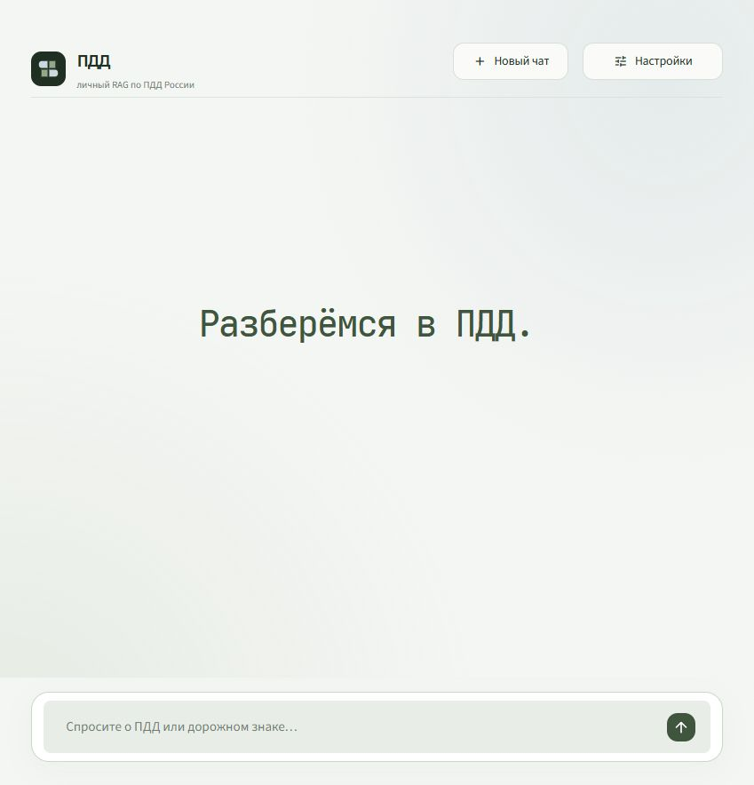
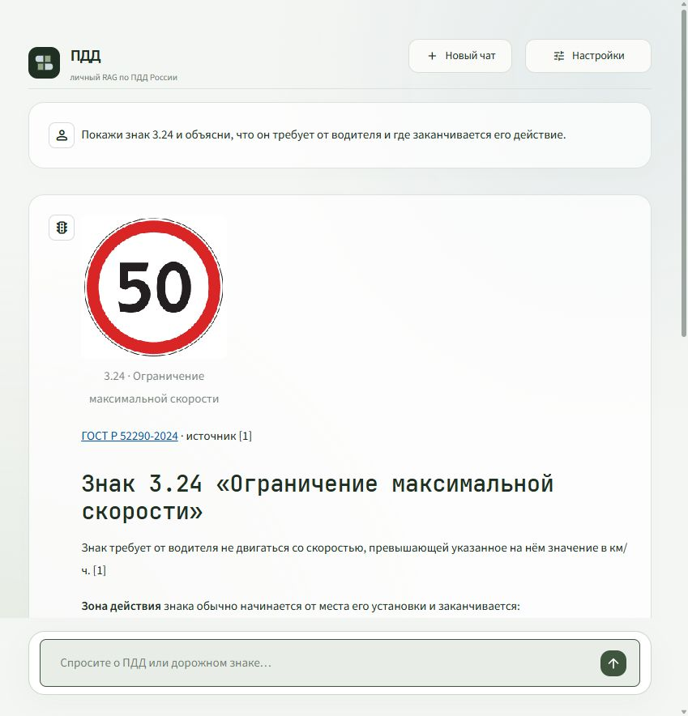

# Личный RAG по ПДД России

Подробное объяснение всей системы: [отчёт PDF в вертикальном A4](../output/pdf/PDD_RAG_Detailed_Report_RU.pdf), [текстовая версия со схемами](PDD_RAG_DETAILED_REPORT_RU.md).

Версия подготовлена 30.10.2026, проверена после перезапуска компьютера 31.10.2026. Это текущая версия сервиса после лабораторного сравнения RuBQ/SciFact.

## Что изменилось

Приложение открывает только ПДД России. Выбор датасетов, карточки чужих вопросов, рекламный текст и экран прежних benchmark убраны. На главной странице остались фраза **«Разберёмся в ПДД»**, поле вопроса, новый чат и настройки. В настройках — поиск, API и состав базы.



Рабочий корпус: **1 164 документа**, **1 564 чанка**, **308 эталонных изображений**, **432 фото**. Используются сохранённые BM25/FAISS/E5-индексы. Первичная индексация ПДД выполнена при сборке корпуса; эта доработка не пересчитывает embeddings.

RuBQ и SciFact больше не предлагаются в интерфейсе и CLI. Их локальные данные и индексы перенесены в `artifacts/archive/legacy-bases-20261030/{data,indices}/`. Это обратимый архив, исключённый из Git. Исторические результаты и query IDs сохранены в [BENCHMARKS.md](../BENCHMARKS.md) и [benchmarks/results.json](../benchmarks/results.json). Восстановить исходные лабораторные команды можно из коммита `0f76e45`.

## Как бот показывает знак

1. Выполняется выбранный текстовый поиск; по умолчанию Hybrid BM25 + Dense + RRF.
2. Номер знака или точное название связываются с записью каталога. Номер пункта нормативного акта не считается автоматически номером знака.
3. В контекст добавляются описание знака, связанные пункты ПДД с зонами действия и исключениями, требования ГОСТ к установке. Диапазоны вроде «3.27–3.30» учитываются; исключения другого знака не переносятся автоматически.
4. Генератор получает до четырёх источников с отдельными номерами. Он объясняет требования по тексту, отличает правила для водителя от правил установки и сообщает о пробелах в источниках.
5. Приложение выводит исходный PNG непосредственно в ответе, перед объяснением. При просьбе показать фото добавляются до двух снимков того же кода из RTSD.

Изображение выбирает код приложения по ID, а не языковая модель по придуманному URL. Путь берётся из локального каталога, должен находиться внутри `data/pdd/images`, байты проверяются по SHA-256. У картинки есть название, код, атрибуция и номер текстового источника. Если файл недоступен или повреждён, текст остаётся доступен, а вместо картинки показывается сообщение.

Для вывода используется [Streamlit st.image](https://docs.streamlit.io/develop/api-reference/media/st.image), поддерживающий локальные файлы и байты изображений. Пиксели не отправляются в текстовый API: генератору передаются названия и виды доступных изображений. Он знает, что сервис покажет их, и не должен утверждать, что картинок нет. Это выдача изображений из базы, а не распознавание загруженного пользователем снимка.

Для вопроса без точного номера/названия остаётся смысловой поиск. Для несуществующего явно указанного кода подходящая картинка не подменяется другим знаком. Если отсутствует часть нормативного описания, сервис должен указать пробел; метаданные ГОСТ не превращаются в выдуманную норму ПДД.



## Проверки

Автоматические проверки: **42 теста**. В них входят сохранение индекса, RRF, fallback Laya, правила цитирования, отсутствие API-квоты, скрытые настройки, сохранение ключей только в памяти, один запрос на отправку, показ картинки без повторной генерации и очистка чата. Добавлены проверки:

- Точное название, голый номер знака, два знака в одном вопросе и точка в конце предложения.
- Различение номера знака и номера пункта; отсутствие совпадений по префиксу.
- Связанные определения, общие зоны действия, исключения и диапазоны кодов.
- Отдельные картинки двух сравниваемых знаков; фотографии только по запросу.
- Отсутствие чужой картинки для неизвестного кода.
- Контроль хеша, неизвестного ID и выхода пути за каталог изображений.

Команда `python -m raglab.cli verify` проверила **547 исходных файлов и 740 изображений**, покрытие всех 26 разделов и связи корпуса. Статус `passed`.

После перезагрузки компьютера 31.10.2026 повторно прошли все 42 теста, проверка корпуса и `pip check`. Сервис восстановлен на порту 8501 и загрузил прежний индекс с manifest от 30.10.2026. Реальный 32-й API-запрос вернул объяснение знака 3.24 со ссылками, его PNG виден в браузере. [Снимок после восстановления](pdd-restart.jpg), [результат проверки](../benchmarks/validation-pdd.json).

Три интеграционных проверки через `gpt-5.6-luna` / sub2api:

| Запрос | Проверенный результат |
|---|---|
| Сравнение 3.27 и 3.28 | Два разных PNG, определения и связанные исключения, допустимые ссылки |
| Фото «Главная дорога» | Эталон 2.1 и два соответствующих фото; нет ложного отказа показать изображение |
| Несуществующий знак 9.99 | Нет подмены картинкой, ответ о недостатке данных |

Это проверки интеграции на выбранных примерах, не независимый benchmark качества ПДД и не измерение Recall/EM/F1. Полный машинный результат: [pdd-integration.json](../benchmarks/pdd-integration.json). Проверка в браузере отдельно подтверждает видимость знака 3.24 и объяснения прямо в диалоге.

Первый живой прогон выявил ошибку обработки кода перед точкой и отсутствие информации о доступных картинках в системном сообщении. После исправлений весь набор пройден повторно; исходный неудачный прогон сохранён локально. Автоматических API-повторов нет, каждая попытка учтена в общем журнале без квоты.

## Что дала Laya

| Старый корпус, одинаковые 50 вопросов | Hybrid nDCG@10 | + reranker nDCG@10 | p50 Hybrid → reranker |
|---|---:|---:|---:|
| RuBQ | 0,5429 | 0,5613 | 33,7 мс → 5 549,3 мс |
| SciFact | 0,6512 | 0,4269 | 22,7 мс → 8 449,8 мс |

На RuBQ reranker немного улучшил порядок результатов; Recall@5 вырос с 0,5633 до 0,7067. На SciFact ранжирование ухудшилось. В обоих случаях задержка выросла до нескольких секунд. Router не показал преимуществ: fallback Hybrid срабатывал в 88% вопросов RuBQ и 96% SciFact; на RuBQ Recall@10 с router снизился с 0,7817 до 0,7217.

Поэтому **убедительного общего выигрыша от Laya не получено**. В личном сервисе по умолчанию используется обычный Hybrid; Laya оставлена дополнительной настройкой. Эти результаты не доказывают пользу или вред Laya для ПДД: у нового корпуса пока нет независимой тестовой разметки. Для вывода по ПДД нужна отдельная выборка, которая не используется для настройки поиска.

## Запуск и воспроизведение

```powershell
.\start.ps1
.\.venv\Scripts\python.exe -X utf8 -m raglab.cli verify
.\.venv\Scripts\python.exe -m pytest -q
```

Явный прогон трёх проверочных API-запросов при наличии ключа в окружении:

```powershell
.\.venv\Scripts\python.exe -X utf8 scripts/check_pdd_answers.py
```

Основные файлы: `app.py` — интерфейс; `raglab/traffic.py` — связи правил и изображений; `raglab/pdd.py` — сборка и проверка корпуса; `raglab/retrieval.py` — поиск; `raglab/generation.py` — ответы и API-учёт. `--json` у команды `ask` возвращает ответ, источники, изображения и диагностику; ключи в результат не входят.

Вопросы независимы от истории. API переключается вручную. Сеть нужна для генерации и явного обновления источников, готовый поиск и изображения работают локально. Реальные ключи, веса, корпус и runtime-журнал исключены из Git.

Нормативная база — снимок на 30.10.2026 с указанными в manifest редакциями. Ограничение независимой сверки последнего изменения ПДД с официальной публикацией и происхождение исторических фото сохранены в [карточке корпуса](PDD_DATASET.md). Система не обновляет законодательство в момент каждого вопроса.
